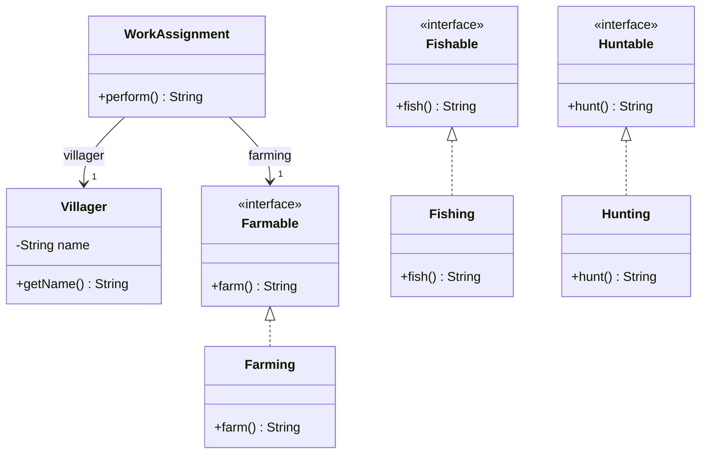

# Composición: comportamiento mediante colaboradores

[Documento principal](README.md) · Anterior: [Interfaces](Interfaces.md) · Siguiente: [Delegación](Delegation.md)

## Propósito

Construir comportamiento combinando objetos en lugar de introducir una subclase por cada variante. Una clase conserva referencias a colaboradores y utiliza sus contratos para cumplir una responsabilidad.

Aquí se utiliza «composición» en el sentido amplio de diseño por colaboración. No implica necesariamente propiedad exclusiva ni dependencia del ciclo de vida, condiciones propias de la [composición como relación UML](../Relationships/Composition.md).

## Separar la implementación del aldeano

En la etapa anterior, las clases de oficio y `FarmerFisher` (AgricultorPescador) repetían las implementaciones de las actividades. El siguiente requisito es extraer esa lógica para reutilizarla mediante colaboradores: `Farming` (Cultivo), `Fishing` (Pesca) y `Hunting` (Caza).

Aquí exploramos una asignación de trabajo que reúne un aldeano y un colaborador de cultivo. La clase base no recibe todos los contratos: la capacidad corresponde al colaborador elegido. En el capítulo siguiente conservaremos la especialización con dos oficios y le haremos delegar sus actividades.

Este ejemplo completo reutiliza los contratos de la etapa anterior. Se incluyen de nuevo para permitir ejecutarlo en una carpeta independiente.

**Archivo: `Farmable.java`**

```java
public interface Farmable {
    public abstract String farm();
}
```

**Archivo: `Fishable.java`**

```java
public interface Fishable {
    public abstract String fish();
}
```

**Archivo: `Huntable.java`**

```java
public interface Huntable {
    public abstract String hunt();
}
```

**Archivo: `Farming.java`**

```java
public final class Farming implements Farmable {
    @Override
    public String farm() {
        return "cultiva con herramientas manuales";
    }
}
```

**Archivo: `Fishing.java`**

```java
public final class Fishing implements Fishable {
    @Override
    public String fish() {
        return "pesca con una red";
    }
}
```

**Archivo: `Hunting.java`**

```java
public final class Hunting implements Huntable {
    @Override
    public String hunt() {
        return "caza siguiendo rastros";
    }
}
```

**Archivo: `Villager.java`**

```java
import java.util.Objects;

public final class Villager {
    private final String name;

    public Villager(String name) {
        this.name = Objects.requireNonNull(name, "name");
        if (name.isBlank()) {
            throw new IllegalArgumentException("El nombre no puede estar vacío");
        }
    }

    public String getName() {
        return name;
    }
}
```

**Archivo: `WorkAssignment.java`**

```java
import java.util.Objects;

public final class WorkAssignment {
    private final Villager villager;
    private final Farmable farming;

    public WorkAssignment(Villager villager, Farmable farming) {
        this.villager = Objects.requireNonNull(villager, "villager");
        this.farming = Objects.requireNonNull(farming, "farming");
    }

    public String perform() {
        return villager.getName() + " " + farming.farm();
    }
}
```

**Archivo: `Main.java`**

```java
public class Main {
    public static void main(String[] args) {
        Farmable farming = new Farming();
        WorkAssignment first = new WorkAssignment(new Villager("Ana"), farming);
        WorkAssignment second = new WorkAssignment(new Villager("Luis"), farming);
        System.out.println(first.perform());
        System.out.println(second.perform());
        System.out.println(new Fishing().fish());
        System.out.println(new Hunting().hunt());
    }
}
```

Salida esperada:

```text
Ana cultiva con herramientas manuales
Luis cultiva con herramientas manuales
pesca con una red
caza siguiendo rastros
```

`WorkAssignment` combina un aldeano y una capacidad de cultivo. El mismo colaborador `Farming` se comparte porque no conserva estado mutable. No existe propiedad exclusiva de ese objeto; el ejemplo no representa composición UML fuerte.

La construcción concreta ocurre en `Main`. `WorkAssignment` recibe la dependencia mediante su constructor y conoce `Farmable`, de modo que puede utilizar otra implementación que respete ese contrato. Esto no exige un framework de inyección de dependencias.

### Diagrama de clases

`WorkAssignment` (Asignación de trabajo) relaciona un `Villager` (Aldeano) con un colaborador que cumple `Farmable` (Capaz de cultivar). Las asociaciones representan referencias a colaboradores; no exigen propiedad exclusiva ni un ciclo de vida compartido.



## Composición y delegación aparecen juntas

Almacenar las referencias describe la estructura de colaboración. En `perform()`, la llamada `farming.farm()` encarga parte de la ejecución al colaborador: esa llamada ya es delegación. Los conceptos se presentan por separado para distinguir sus preguntas, aunque puedan aparecer en el mismo código.

| Concepto | Pregunta |
| --- | --- |
| Composición | ¿Con qué objetos se construye el comportamiento? |
| Delegación | ¿Qué objeto ejecuta esta parte de la operación? |
| Herencia | ¿Qué contrato de un tipo base conserva el subtipo? |

## Costos y límites

La composición añade referencias, construcción y decisiones sobre la colaboración. No todos los comportamientos requieren una clase separada. Tampoco significa que cada dependencia necesite un setter: aquí los colaboradores se establecen al construir la asignación y no se sustituyen después.

Un colaborador compartido con estado mutable exigiría revisar sus efectos entre clientes y su uso concurrente. Declarar la referencia `final` solo impide reasignarla; no protege el estado interno del objeto.

## Comprobación conceptual

- ¿Qué código cambiaría para introducir otra técnica de cultivo?
- ¿Por qué compartir `Farming` no demuestra una relación UML de propiedad exclusiva?
- ¿Qué requisito justificaría permitir sustituir una dependencia después de construir la asignación?

La siguiente etapa examina la [delegación](Delegation.md) y la responsabilidad de la API que recibe la solicitud.
