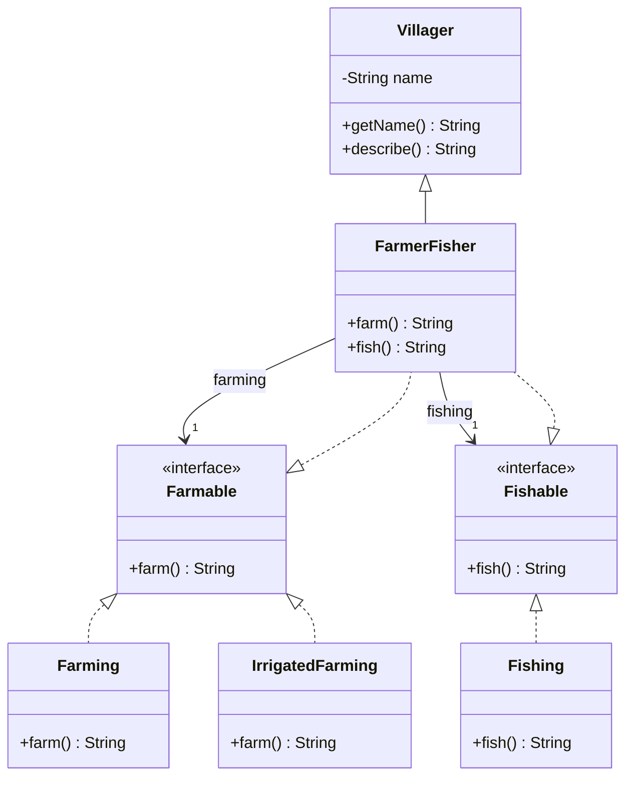

# Delegación: distribuir la ejecución de responsabilidades

[Documento principal](README.md) · Anterior: [Composición](Composition.md) · Siguiente: [Inmutabilidad](Immutability.md)

## Propósito

Distinguir el objeto que recibe una solicitud del colaborador que realiza parte del trabajo. La delegación permite reutilizar una implementación y conservar una API adecuada para el cliente.

## Una API explícita para dos capacidades

Retomamos `FarmerFisher` (AgricultorPescador), que extiende `Villager` (Aldeano) e implementa dos capacidades. Ahora recibe los colaboradores de cultivo y pesca por constructor y delega en ellos las actividades, en lugar de repetir sus algoritmos. Así combinamos herencia para la identidad común, interfaces para los contratos y composición para reutilizar las implementaciones.

Ejemplo completo, independiente de las variantes anteriores.

**Archivo: `Farmable.java`**

```java
public interface Farmable {
    public abstract String farm();
}
```

**Archivo: `Fishable.java`**

```java
public interface Fishable {
    public abstract String fish();
}
```

**Archivo: `Farming.java`**

```java
public final class Farming implements Farmable {
    @Override
    public String farm() {
        return "cultiva con herramientas manuales";
    }
}
```

**Archivo: `IrrigatedFarming.java`**

```java
public final class IrrigatedFarming implements Farmable {
    @Override
    public String farm() {
        return "cultiva con un sistema de riego";
    }
}
```

**Archivo: `Fishing.java`**

```java
public final class Fishing implements Fishable {
    @Override
    public String fish() {
        return "pesca con una red";
    }
}
```

**Archivo: `Villager.java`**

```java
public class Villager {
    private final String name;

    public Villager(String name) {
        this.name = name;
    }

    public String getName() {
        return name;
    }

    public String describe() {
        return "Aldeano: " + name;
    }
}
```

**Archivo: `FarmerFisher.java`**

```java
public class FarmerFisher extends Villager implements Farmable, Fishable {
    private final Farmable farming;
    private final Fishable fishing;

    public FarmerFisher(String name, Farmable farming, Fishable fishing) {
        super(name);
        this.farming = farming;
        this.fishing = fishing;
    }

    @Override
    public String farm() {
        return getName() + " " + farming.farm();
    }

    @Override
    public String fish() {
        return getName() + " " + fishing.fish();
    }
}
```

**Archivo: `Main.java`**

```java
public class Main {
    public static void main(String[] args) {
        FarmerFisher ana = new FarmerFisher("Ana", new Farming(), new Fishing());
        Farmable luis = new FarmerFisher("Luis", new IrrigatedFarming(), new Fishing());
        System.out.println(ana.farm());
        System.out.println(ana.fish());
        System.out.println(luis.farm());
    }
}
```

Salida esperada:

```text
Ana cultiva con herramientas manuales
Ana pesca con una red
Luis cultiva con un sistema de riego
```

La secuencia de `ana.farm()` es: el cliente solicita cultivar a `FarmerFisher` (AgricultorPescador); el aldeano llama a `farming.farm()`; el colaborador devuelve la descripción de la técnica; el aldeano añade su nombre y devuelve el resultado. En este ejemplo las actividades solo producen texto.

La especialización conserva la responsabilidad de asociar la actividad con el nombre del aldeano. Los colaboradores recibidos deben ser no nulos. El colaborador define la técnica de trabajo. La delegación puede incorporar coordinación o validación: no tiene que limitarse a reenviar una llamada sin cambios.

### Diagrama de clases

`FarmerFisher` (AgricultorPescador) conserva la herencia de `Villager` (Aldeano), cumple los contratos y mantiene referencias a los colaboradores. Las implementaciones de cultivo son alternativas para la misma dependencia.



El diagrama muestra la estructura; la delegación ocurre cuando `farm()` (cultivar) y `fish()` (pescar) llaman a sus respectivos colaboradores.

## Configuración y sustitución

Ana y Luis utilizan distintas implementaciones de cultivo sin crear nuevas subclases de aldeano. La elección se realiza al construirlos. Las referencias `final` impiden cambiarlas posteriormente; variar entre instancias no equivale a sustituir comportamientos durante la ejecución.

Si un requisito futuro exige cambiar de técnica en un objeto ya existente, habrá que decidir cómo validar esa transición y qué ocurre con las operaciones en curso. No se incorpora un setter solo por anticipar esa posibilidad.

## Elegir quién expone las operaciones

| Alternativa | Ventaja | Costo |
| --- | --- | --- |
| El aldeano ofrece `farm()` y `fish()` | El cliente utiliza una API directa | Agregar otra capacidad pública exige revisar esa API |
| Un servicio, como `WorkAssignment`, coordina la actividad | Mantiene pequeño el modelo del aldeano | El cliente utiliza un objeto adicional |
| Un registro permite recuperar capacidades por tipo | Admite conjuntos variables de capacidades | Requiere definir ausencia, duplicados y recuperación segura |

El ejemplo utiliza la primera alternativa y garantiza ambas capacidades mediante dependencias obligatorias. La garantía corresponde a `FarmerFisher` (AgricultorPescador), no a todos los objetos de `Villager` (Aldeano). No representa aldeanos con conjuntos arbitrarios de oficios. Introducir una colección genérica o búsquedas con `instanceof` sería otra decisión, con costos propios.

## Comprobación conceptual

- ¿Qué responsabilidad conserva `FarmerFisher` (AgricultorPescador) después de delegar?
- ¿Qué cambia para agregar otra técnica de cultivo? ¿Y para agregar una nueva capacidad pública?
- ¿Por qué el código no garantiza inmutabilidad profunda aunque todos los campos sean `final`?

La siguiente etapa aborda el [control del estado mediante inmutabilidad](Immutability.md).
