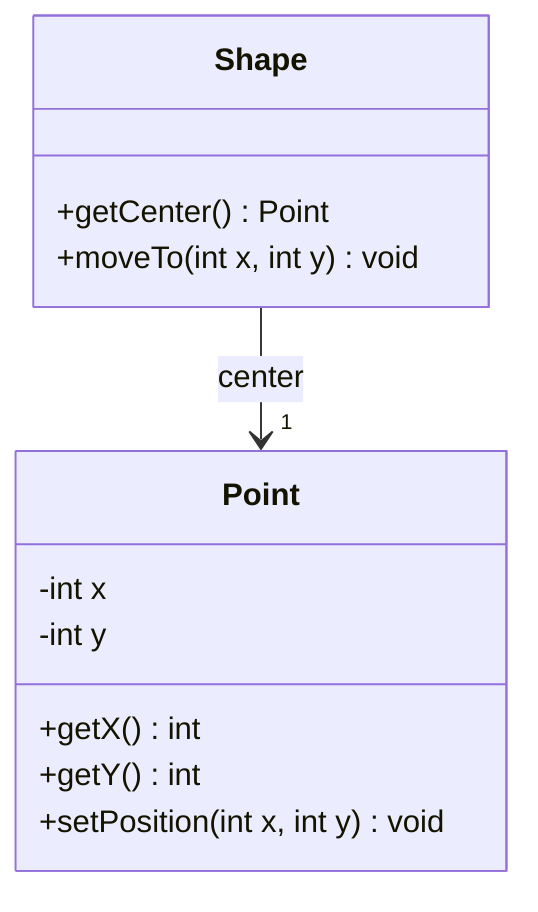
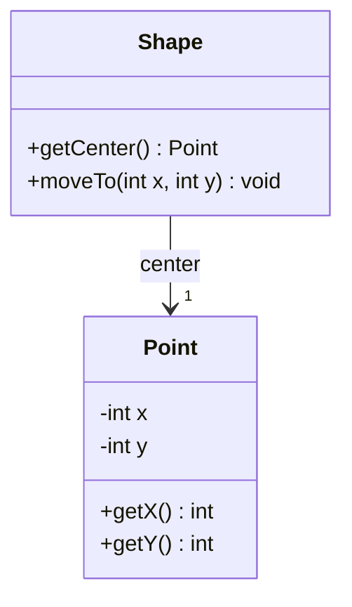
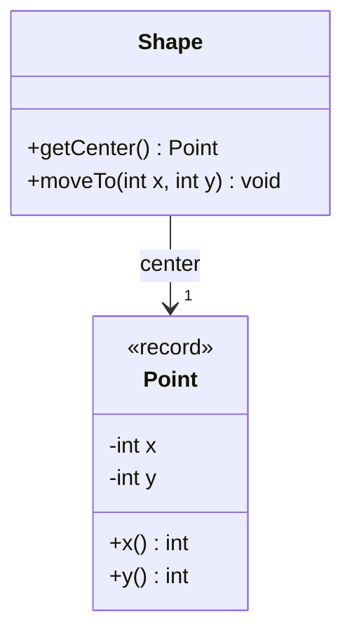

# Inmutabilidad: controlar los cambios en el estado

[Documento principal](README.md) · Anterior: [Delegación](Delegation.md)

## Propósito

Comprender la mutabilidad y la inmutabilidad como decisiones de diseño. Primero se presenta una clase mutable, después una clase convencional inmutable y finalmente un `record` como alternativa para expresar ciertos valores con menos código.

## Mutabilidad e inmutabilidad

Un objeto es **mutable** si su estado observable puede cambiar después de construirse. Un mutador modifica el mismo objeto; todas las referencias a ese objeto permiten observar el cambio. Los setters son una forma de mutador, pero también lo son otras operaciones que alteran el estado.

Un objeto es **inmutable** si su estado observable permanece estable durante toda su vida. Puede ofrecer operaciones: cuando estas representan un cambio, pueden devolver otro objeto sin modificar el original.

Reemplazar una referencia no es modificar el objeto al que apuntaba. Una figura puede cambiar su posición asignándose otro punto, mientras el punto anterior permanece intacto. Así, una entidad mutable puede contener valores inmutables.

La inmutabilidad no depende de `record`. Una clase convencional puede diseñarse como mutable o inmutable. El `record` es una herramienta de Java para expresar valores mediante componentes; sus garantías deben analizarse según los datos que contiene.

Las tres versiones usan los nombres `Point` (Punto) y `Shape` (Figura). Son etapas alternativas: los archivos de cada versión se mantienen separados.

## Primera versión: clases mutables

`Point` (Punto) permite cambiar sus coordenadas. `Shape` (Figura) guarda ese punto y devuelve la misma referencia mediante su getter.

**Archivo: `Point.java`**

```java
public class Point {
    private int x;
    private int y;

    public Point() {
        this(0, 0);
    }

    public Point(int x, int y) {
        this.x = x;
        this.y = y;
    }

    public int getX() {
        return x;
    }

    public int getY() {
        return y;
    }

    public void setPosition(int x, int y) {
        this.x = x;
        this.y = y;
    }
}
```

**Archivo: `Shape.java`**

```java
public class Shape {
    private Point center;

    public Shape() {
        this(new Point());
    }

    public Shape(Point center) {
        this.center = center;
    }

    public Point getCenter() {
        return center;
    }

    public void setCenter(Point center) {
        this.center = center;
    }

    public void moveTo(int x, int y) {
        center.setPosition(x, y);
    }
}
```

### Uso: el problema de compartir el punto

Dos figuras reciben el mismo punto. Cambiarlo desde una afecta también a la otra y a la referencia guardada como posición anterior.

**Archivo: `Test.java`**

```java
public class Test {
    public static void main(String[] args) {
        Point shared = new Point(0, 0);
        Shape first = new Shape(shared);
        Shape second = new Shape(shared);
        Point previous = first.getCenter();

        first.getCenter().setPosition(10, 20);

        System.out.println("First: " + first.getCenter().getX()
                + ", " + first.getCenter().getY());
        System.out.println("Second: " + second.getCenter().getX()
                + ", " + second.getCenter().getY());
        System.out.println("Previous: " + previous.getX()
                + ", " + previous.getY());
    }
}
```

Salida esperada:

```text
First: 10, 20
Second: 10, 20
Previous: 10, 20
```

El desplazamiento funciona, pero sus efectos alcanzan a todas las referencias al mismo punto. Esto es un problema si las figuras deben moverse independientemente.

### Diagrama de clases



## Segunda versión: clase Point inmutable

Conservamos los nombres. Cambia la implementación: el punto no tiene mutadores y la figura reemplaza su centro al desplazarse.

**Archivo: `Point.java`**

```java
public final class Point {
    private final int x;
    private final int y;

    public Point(int x, int y) {
        this.x = x;
        this.y = y;
    }

    public int getX() {
        return x;
    }

    public int getY() {
        return y;
    }
}
```

Los campos privados y finales, la ausencia de mutadores y la clase final protegen el punto. Sus coordenadas son enteros, por lo que no hay objetos internos mutables que puedan escapar.

**Archivo: `Shape.java`**

```java
public class Shape {
    private Point center;

    public Shape() {
        this(new Point(0, 0));
    }

    public Shape(Point center) {
        this.center = center;
    }

    public Point getCenter() {
        return center;
    }

    public void moveTo(int x, int y) {
        center = new Point(x, y);
    }
}
```

### Uso: conservar la posición anterior

**Archivo: `Test.java`**

```java
public class Test {
    public static void main(String[] args) {
        Point shared = new Point(0, 0);
        Shape first = new Shape(shared);
        Shape second = new Shape(shared);
        Point previous = first.getCenter();

        first.moveTo(10, 20);

        System.out.println("First: " + first.getCenter().getX()
                + ", " + first.getCenter().getY());
        System.out.println("Second: " + second.getCenter().getX()
                + ", " + second.getCenter().getY());
        System.out.println("Previous: " + previous.getX()
                + ", " + previous.getY());
    }
}
```

Salida esperada:

```text
First: 10, 20
Second: 0, 0
Previous: 0, 0
```

Solo cambia el centro de la primera figura. La segunda y la posición anterior conservan sus valores. La figura sigue siendo mutable; el punto es inmutable.

### Diagrama de clases



## Encapsulamiento y mutadores

Un campo privado no basta si un getter devuelve una referencia interna mutable. En la primera versión, el cliente modifica el centro sin pasar por la operación de movimiento de la figura.

En la segunda, devolver el punto es seguro porque sus coordenadas no pueden cambiar. La figura controla el desplazamiento mediante `moveTo()` (mover a), que reemplaza su referencia al centro.

Un mutador cambia el estado de un objeto existente. Tanto `setPosition()` (establecer posición) como `moveTo()` (mover a) son mutadores de sus respectivos objetos. No necesitamos eliminar la mutabilidad de la figura para proteger los valores que utiliza.

También se puede proteger una figura con puntos mutables mediante copias defensivas al recibirlos y devolverlos. La clase inmutable evita tener que copiar el punto para compartirlo de forma segura.

## Tercera versión: Point como record

La clase convencional ya resolvió la inmutabilidad. Ahora un `record` permite expresar el mismo punto con menos código.

**Archivo: `Point.java`**

```java
public record Point(int x, int y) {
}
```

El `record` genera el constructor, los campos privados y finales y los accesores `x()` (coordenada x) e `y()` (coordenada y). La figura conserva la misma estrategia de movimiento.

**Archivo: `Shape.java`**

```java
public class Shape {
    private Point center;

    public Shape() {
        this(new Point(0, 0));
    }

    public Shape(Point center) {
        this.center = center;
    }

    public Point getCenter() {
        return center;
    }

    public void moveTo(int x, int y) {
        center = new Point(x, y);
    }
}
```

### Uso con record

La única diferencia en las consultas son los nombres de los accesores.

**Archivo: `Test.java`**

```java
public class Test {
    public static void main(String[] args) {
        Point shared = new Point(0, 0);
        Shape first = new Shape(shared);
        Shape second = new Shape(shared);
        Point previous = first.getCenter();

        first.moveTo(10, 20);

        System.out.println("First: " + first.getCenter().x()
                + ", " + first.getCenter().y());
        System.out.println("Second: " + second.getCenter().x()
                + ", " + second.getCenter().y());
        System.out.println("Previous: " + previous.x()
                + ", " + previous.y());
    }
}
```

Salida esperada:

```text
First: 10, 20
Second: 0, 0
Previous: 0, 0
```

### Diagrama de clases



### Comparación de las tres versiones

| Alternativa | Ventaja | Costo o límite |
| --- | --- | --- |
| Punto mutable | Permite actualizar el mismo objeto. | Las referencias compartidas observan los cambios; exige controlar quién puede modificarlo. |
| Clase convencional inmutable | Valores estables con control de representación y API. | Requiere escribir constructor y accesores. |
| Record con coordenadas enteras | Las mismas garantías de estabilidad con menos código. | Sus componentes determinan su API pública y restringe la representación y la herencia. |

Crear nuevos valores al cambiar de posición es una consecuencia del diseño inmutable, tanto con una clase como con un `record`. La clase convencional ofrece más libertad para ocultar la representación y diseñar su API. El `record` resulta adecuado cuando el valor se describe naturalmente mediante sus componentes.

## Ventajas y límites

Los puntos inmutables permiten compartir una posición sin cambios inesperados y conservar posiciones anteriores. La figura sigue siendo mutable y controla sus movimientos mediante su propia API.

Cada movimiento crea otro punto. Ese costo debe evaluarse cuando hay muchas actualizaciones; una clase mutable con acceso controlado también puede ser adecuada.

Un `record` con una lista mutable no sería automáticamente inmutable: habría que proteger esa lista. En este ejemplo, las coordenadas son enteros y no presentan ese problema.

## Comprobación conceptual

- ¿Por qué cambia el centro de la segunda figura en la primera versión?
- ¿Por qué una referencia al punto mutable no conserva una posición anterior?
- ¿Cómo protegerías la figura manteniendo una clase de punto mutable?
- ¿Por qué la figura que utiliza un punto inmutable sigue siendo mutable?
- ¿Qué decisiones hacen inmutable a la clase convencional y qué código permite omitir el `record`?
