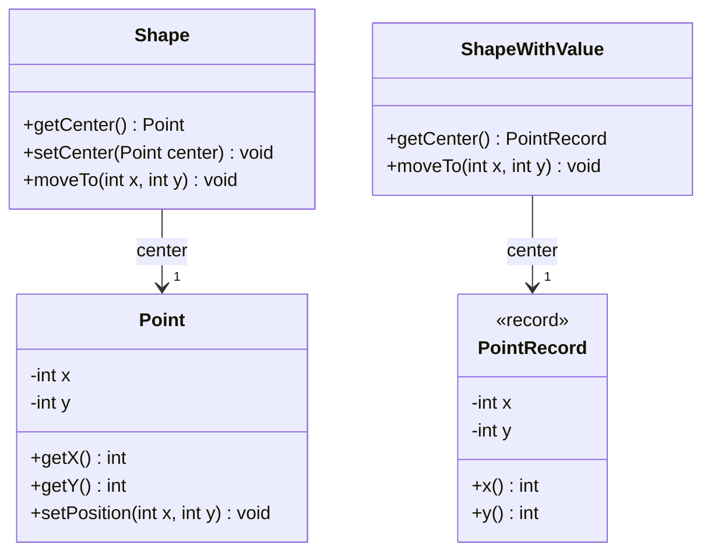

# Inmutabilidad: controlar los cambios en el estado

[Documento principal](README.md) · Anterior: [Delegación](Delegation.md)

## Propósito

Comparar una figura cuyo centro es un punto mutable con otra que utiliza un valor inmutable. El objetivo es observar qué ocurre al compartir referencias, cómo se protege el estado y qué aporta un `record` frente a una clase convencional.

Hay dos decisiones distintas: **mutabilidad frente a inmutabilidad** y **clase convencional frente a `record`**. Una clase convencional también puede ser inmutable. El `record` facilita expresar ciertos valores con menos código; no convierte automáticamente cualquier modelo en un mejor diseño.

## Primera versión: un punto mutable dentro de una figura

`Point` (Punto) permite modificar sus coordenadas. `Shape` (Figura) guarda un punto como centro y lo devuelve mediante un getter. Para modificar ambas coordenadas usamos `setPosition()` (establecer posición), en lugar de un setter de una sola coordenada.

**Archivo: `Point.java`**

```java
public class Point {
    private int x;
    private int y;

    public Point() {
        this(0, 0);
    }

    public Point(int x, int y) {
        this.x = x;
        this.y = y;
    }

    public int getX() {
        return x;
    }

    public int getY() {
        return y;
    }

    public void setPosition(int x, int y) {
        this.x = x;
        this.y = y;
    }
}
```

**Archivo: `Shape.java`**

```java
public class Shape {
    private Point center;

    public Shape() {
        this(new Point());
    }

    public Shape(Point center) {
        this.center = center;
    }

    public Point getCenter() {
        return center;
    }

    public void setCenter(Point center) {
        this.center = center;
    }

    public void moveTo(int x, int y) {
        center.setPosition(x, y);
    }
}
```

El siguiente recorrido es válido y desplaza el centro hasta la posición `(99, 99)`:

```java
Shape shape = new Shape();
for (int step = 0; step < 100; step += 1) {
    shape.getCenter().setPosition(step, step);
}
```

**No necesitamos un `record` para que este desplazamiento funcione.** Si nadie más comparte el punto y se acepta que el cliente lo modifique directamente, esta solución puede ser suficiente.

## El problema aparece al compartir el punto

El campo privado no basta para proteger el centro: `getCenter()` (obtener centro) devuelve la misma referencia mutable. El cliente puede modificar la figura sin llamar a una operación de la propia figura.

Además, dos figuras pueden recibir el mismo punto. Desplazar una modifica también el centro de la otra. Una referencia guardada como «posición anterior» tampoco conserva una instantánea: sigue apuntando al objeto que cambia.

Esto es un problema si las figuras deben moverse independientemente o si necesitamos conservar posiciones anteriores. Si compartir deliberadamente una posición móvil fuera el requisito, ese mismo comportamiento podría ser correcto.

## Segunda versión: la figura conserva un valor inmutable

`PointRecord` (Registro de punto) representa una posición estable. Sus coordenadas son enteros, por lo que no hay componentes mutables internos. Para desplazar una figura, `ShapeWithValue` (Figura con valor) reemplaza su referencia al centro por otro punto.

**Archivo: `PointRecord.java`**

```java
public record PointRecord(int x, int y) {
}
```

**Archivo: `ShapeWithValue.java`**

```java
public class ShapeWithValue {
    private PointRecord center;

    public ShapeWithValue() {
        this(new PointRecord(0, 0));
    }

    public ShapeWithValue(PointRecord center) {
        this.center = center;
    }

    public PointRecord getCenter() {
        return center;
    }

    public void moveTo(int x, int y) {
        center = new PointRecord(x, y);
    }
}
```

La figura **sigue siendo mutable**: su centro actual cambia. El punto, en cambio, permanece inmutable. Podemos devolverlo sin permitir que el cliente altere sus coordenadas; para cambiar la posición de la figura hay que utilizar su operación `moveTo()` (mover a).

El recorrido equivalente queda así:

```java
ShapeWithValue shape = new ShapeWithValue();
for (int step = 0; step < 100; step += 1) {
    shape.moveTo(step, step);
}
```

Cada iteración crea otro valor. Los puntos anteriores permanecen intactos si alguien conserva sus referencias.

## Demostración: dos figuras y una posición anterior

**Archivo: `Test.java`**

```java
public class Test {
    public static void main(String[] args) {
        Point sharedPoint = new Point(0, 0);
        Shape first = new Shape(sharedPoint);
        Shape second = new Shape(sharedPoint);
        Point previous = first.getCenter();

        first.getCenter().setPosition(10, 20);

        System.out.println("Mutable second: "
                + second.getCenter().getX() + ", " + second.getCenter().getY());
        System.out.println("Mutable previous: "
                + previous.getX() + ", " + previous.getY());

        PointRecord sharedValue = new PointRecord(0, 0);
        ShapeWithValue firstValue = new ShapeWithValue(sharedValue);
        ShapeWithValue secondValue = new ShapeWithValue(sharedValue);
        PointRecord previousValue = firstValue.getCenter();

        firstValue.moveTo(10, 20);

        System.out.println("Value first: " + firstValue.getCenter());
        System.out.println("Value second: " + secondValue.getCenter());
        System.out.println("Value previous: " + previousValue);
    }
}
```

Salida esperada:

```text
Mutable second: 10, 20
Mutable previous: 10, 20
Value first: PointRecord[x=10, y=20]
Value second: PointRecord[x=0, y=0]
Value previous: PointRecord[x=0, y=0]
```

En la primera versión, se modificó un objeto compartido: cambió la otra figura y se perdió la supuesta posición anterior. En la segunda, solo se reemplazó la referencia de la primera figura. La otra figura y el punto anterior conservaron sus valores.

### Diagrama de clases



## Encapsulamiento y mutadores

Encapsular significa controlar cómo se consulta y modifica el estado, no solo declarar campos privados. En la primera versión, el getter deja escapar una referencia mutable y permite evitar la API de movimiento de la figura. Cualquier validación o actualización adicional situada en esa API podría omitirse.

También puede protegerse una figura **sin usar un `record`**: copiar el punto recibido, devolver copias defensivas y ofrecer operaciones controladas para moverla. Hay que proteger tanto las referencias de entrada como las de salida. Otra opción es implementar el punto como una clase convencional inmutable.

Un mutador es cualquier método que cambia un objeto existente, no únicamente un setter. En estos ejemplos, `setPosition()` (establecer posición), `setCenter()` (establecer centro) y ambos métodos `moveTo()` (mover a) son mutadores de sus respectivos objetos. Reemplazar un centro inmutable no vuelve inmutable a la figura.

La segunda versión elimina los mutadores del **valor punto**, no los de la entidad figura. Esa combinación permite que una entidad evolucione mientras los valores compartidos o conservados como historial permanecen estables.

## Entonces, ¿qué aporta específicamente el record?

La independencia entre figuras y la conservación de posiciones anteriores provienen de **usar valores inmutables**, no de la palabra `record`. Una clase convencional inmutable podría ofrecer exactamente esas garantías.

El aporte del `record` es expresar de forma breve un valor definido por sus componentes. En este caso genera:

- El constructor que recibe las dos coordenadas.
- Los campos privados y finales y los accesores `x()` (coordenada x) e `y()` (coordenada y).
- La igualdad y el código hash basados en las coordenadas.
- Una representación textual útil, como la mostrada en el ejemplo.

Con una clase convencional hay que escribir esos elementos si se desean las mismas características. No basta con quitar los setters: deben protegerse el estado y la extensión, y definir la igualdad por contenido cuando el dominio la requiera.

| Alternativa | Ventaja | Costo o límite |
| --- | --- | --- |
| Punto mutable | Se puede actualizar el mismo objeto sin construir un punto por desplazamiento. | Las referencias compartidas observan los cambios; exige controlar quién puede modificarlo. |
| Clase convencional inmutable | Valores estables con control de representación y API. | Requiere escribir y mantener constructor, accesores y, si corresponde, igualdad y código hash. |
| Record con coordenadas enteras | Valores estables y semántica de valor con muy poco código. | Cada nueva posición requiere otro valor; los componentes determinan su API pública. |

Una clase convencional permite más libertad para ocultar su representación, añadir campos de instancia y utilizar herencia. Un `record` no admite campos de instancia adicionales a sus componentes, no puede extender una clase elegida por el programador ni admitir subclases. Sí puede implementar interfaces y definir operaciones.

## Ventajas y límites de los valores inmutables

Las ventajas visibles en el ejemplo son compartir posiciones sin interferencia, conservar valores anteriores y concentrar los cambios de la figura en su propia API. Además, los valores estables facilitan razonar sobre operaciones, conservar invariantes y usar claves cuyo estado no cambie después de almacenarlas en una colección.

La contrapartida es crear nuevos valores y, cuando hay estructuras mayores, realizar posibles copias. En un recorrido de muchas actualizaciones ese costo merece evaluarse según el uso real. La mutabilidad controlada puede ser adecuada para estructuras que cambian con mucha frecuencia.

Un `record` no garantiza inmutabilidad profunda: si un componente contiene una lista mutable, el cliente puede modificarla si no se protege. Los componentes finales solo impiden reasignar sus campos. El punto del ejemplo evita ese problema al contener únicamente enteros.

Compartir puntos inmutables evita modificaciones concurrentes de sus coordenadas, pero la figura mutable todavía necesita coordinación si varias tareas actualizan su centro. La inmutabilidad de los valores no resuelve todos los problemas del objeto que los contiene.

## Comprobación conceptual

- ¿Por qué cambia el centro de la segunda figura en la primera versión?
- ¿Por qué una referencia al punto mutable no conserva una posición anterior?
- ¿Cómo protegerías la figura manteniendo una clase de punto mutable?
- ¿Por qué la figura que utiliza un `record` sigue siendo mutable?
- ¿Qué ventajas provienen de la inmutabilidad y cuáles del código generado por el `record`?
