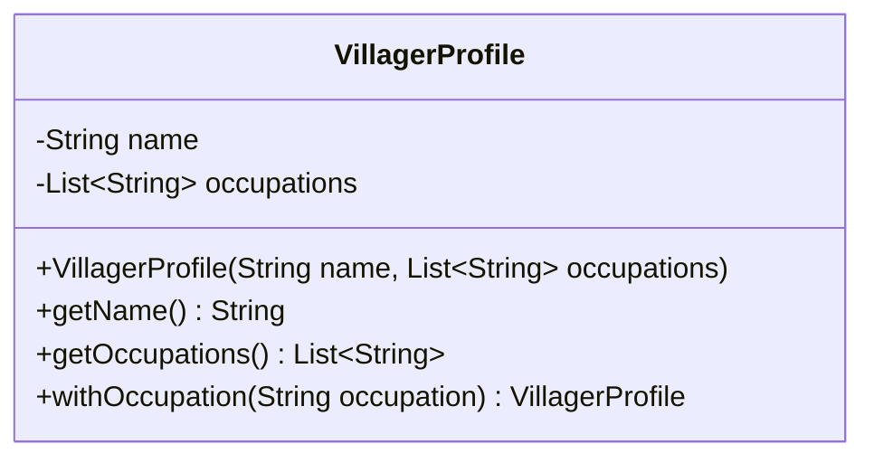

# Inmutabilidad: controlar los cambios en el estado

[Documento principal](README.md) · Anterior: [Delegación](Delegation.md)

## Propósito

Comprender cuándo conviene mantener estable el estado de un objeto, qué ventajas aporta y cómo protegerlo mediante encapsulamiento. Herencia, interfaces, composición y delegación organizan tipos y comportamiento; la inmutabilidad aborda otra dimensión: **qué puede cambiar después de construir un objeto**.

Un objeto inmutable conserva su estado observable durante toda su vida. Puede ofrecer operaciones y calcular resultados; si una operación representa un cambio de valor, devuelve otro objeto sin modificar el anterior. Este principio no depende de los `record` ni de un lenguaje específico.

## El problema: compartir un objeto que puede cambiar

La aldea necesita conservar el perfil de un habitante al registrar una asignación de trabajo. El perfil contiene su nombre y los nombres de sus oficios; no contiene los colaboradores que ejecutan las actividades.

Si varias asignaciones guardan una referencia al mismo perfil mutable, un cambio posterior puede afectar a todas. Una asignación que debía conservar la información original podría terminar mostrando oficios adquiridos después. Para entender su resultado ya no basta con conocer el perfil inicial: también hay que seguir quién lo modificó y cuándo.

Un perfil inmutable permite conservar una versión estable y compartirla entre asignaciones. Cuando cambian los datos, se construye una nueva versión para los usos que deban reflejar el cambio. La entidad que representa al habitante puede seguir siendo mutable: **la persona y el valor que describe su perfil tienen responsabilidades distintas**.

## Ventajas de uso

| Ventaja | Consecuencia en el caso de la aldea |
| --- | --- |
| Razonamiento local | Una vez recibido un perfil, otra parte del programa no puede cambiar sus datos mientras lo consultamos. |
| Conservación de versiones | Una asignación conserva el perfil original aunque se cree otro con nuevos oficios. |
| Compartición segura del valor | Varias asignaciones pueden consultar el mismo perfil sin interferir mediante modificaciones. |
| Invariantes estables | Las reglas comprobadas al construirlo se conservan porque no hay cambios posteriores de su estado. |
| Pruebas más sencillas | Una operación puede verificarse por su entrada y resultado sin reconstruir un historial de mutaciones del perfil. |

Los valores inmutables también son útiles como claves de colecciones cuando tienen igualdad por contenido: su estado no cambia después de calcular la igualdad o el código hash. En concurrencia, evitan carreras sobre su propio estado, pero no resuelven por sí solos la coordinación de operaciones ni el acceso a referencias compartidas que se reemplazan.

## Encapsulamiento: controlar el acceso y el cambio

Encapsular significa proteger la representación y las reglas del objeto mediante una API controlada. Declarar campos privados es parte de esa protección, pero no basta si los métodos permiten modificar el estado de cualquier manera.

**Encapsulamiento e inmutabilidad se complementan:** un objeto mutable bien encapsulado controla sus transiciones válidas; uno inmutable protege el estado establecido durante su construcción y evita modificaciones posteriores.

Un método de acceso también puede romper el encapsulamiento. Si devuelve la lista mutable interna de oficios, el cliente puede modificarla aunque el campo sea privado y no exista un setter. Lo mismo ocurre si el constructor almacena directamente una lista que el cliente conserva y puede modificar.

Por eso hay que proteger las dos fronteras:

- **Entrada:** evitar que cambios posteriores en los objetos recibidos alteren el estado interno.
- **Salida:** evitar que los objetos devueltos permitan modificar ese estado desde fuera.

## ¿Qué ocurre con los mutadores?

Un mutador es cualquier operación que modifica el estado de un objeto existente. Puede llamarse `setName()` (establecer nombre), `addOccupation()` (agregar oficio) o tener un nombre propio del dominio. **Eliminar los setters no garantiza inmutabilidad** si permanecen otras operaciones mutadoras o referencias internas expuestas.

Los mutadores son apropiados cuando el dominio requiere que una entidad con la misma identidad cambie durante su vida. Deben expresar transiciones válidas y conservar sus invariantes; no es necesario proporcionar un setter por cada campo.

Para un valor inmutable, una operación como `withOccupation()` (con oficio) produce otro valor. El cliente decide si conserva el anterior, utiliza el nuevo o reemplaza una referencia que mantiene una entidad. Reasignar una variable a otro objeto no modifica el objeto anterior.

## Implementación con una clase convencional

`VillagerProfile` (Perfil de aldeano) muestra el principio sin depender de un `record`. El nombre debe ser no nulo y no estar en blanco; los oficios deben ser no nulos y no estar en blanco. Se permite un perfil sin oficios, y agregar uno ya presente conserva el mismo contenido.

**Archivo: `VillagerProfile.java`**

```java
import java.util.ArrayList;
import java.util.List;

public final class VillagerProfile {
    private final String name;
    private final List<String> occupations;

    public VillagerProfile(String name, List<String> occupations) {
        if (name == null || name.isBlank()) {
            throw new IllegalArgumentException("Invalid name");
        }
        this.name = name;
        this.occupations = List.copyOf(occupations);
        for (String occupation : this.occupations) {
            if (occupation.isBlank()) {
                throw new IllegalArgumentException("Invalid occupation");
            }
        }
    }

    public String getName() {
        return name;
    }

    public List<String> getOccupations() {
        return occupations;
    }

    public VillagerProfile withOccupation(String occupation) {
        List<String> updatedOccupations = new ArrayList<>(occupations);
        if (!updatedOccupations.contains(occupation)) {
            updatedOccupations.add(occupation);
        }
        return new VillagerProfile(name, updatedOccupations);
    }
}
```

La copia mediante `List.copyOf()` (copia de lista) no refleja cambios posteriores en la lista recibida y no permite modificaciones desde el acceso público. También rechaza una lista nula o elementos nulos. No es necesario copiar al devolverla porque es una lista no modificable cuyos elementos son cadenas inmutables.

La copia es superficial: si los elementos fueran objetos mutables, habría que proteger también su estado o utilizar elementos inmutables. Una colección no modificable no convierte automáticamente sus elementos en inmutables.

### Uso: conservar el original y crear una nueva versión

**Archivo: `Test.java`**

```java
import java.util.ArrayList;
import java.util.List;

public class Test {
    public static void main(String[] args) {
        List<String> occupations = new ArrayList<>(List.of("agricultura"));
        VillagerProfile original = new VillagerProfile("Ana", occupations);

        occupations.add("caza");
        VillagerProfile updated = original.withOccupation("pesca");

        System.out.println(original.getName() + ": " + original.getOccupations());
        System.out.println(updated.getName() + ": " + updated.getOccupations());
    }
}
```

Salida esperada:

```text
Ana: [agricultura]
Ana: [agricultura, pesca]
```

Agregar caza a la lista externa no altera el perfil. Agregar pesca mediante `withOccupation()` (con oficio) crea otro perfil: el original conserva sus datos. La lógica del dominio devuelve valores; la impresión corresponde únicamente al programa de ejemplo.

### Diagrama de clases



El diagrama muestra la API del perfil; su inmutabilidad depende de la implementación y de la protección de las referencias, no solo de la visibilidad de los campos.

## Qué garantiza cada mecanismo

| Mecanismo | Garantía | Lo que aún debe revisarse |
| --- | --- | --- |
| Campo privado | El cliente no accede directamente al campo | Los métodos pueden exponer referencias mutables o permitir cambios inválidos. |
| Campo `final` | El campo no se reasigna tras inicializarse | El objeto referenciado puede seguir cambiando. |
| Clase `final` | No admite subclases que alteren el comportamiento | Sus propios métodos y datos pueden ser mutables. |
| Ausencia de mutadores | La API no ofrece cambios directos de estado | Las referencias recibidas o devueltas pueden abrir otras vías de cambio. |
| Vista no modificable | Impide modificar una colección a través de esa vista | Puede reflejar cambios en la colección original. |
| Copia defensiva | Aísla el estado respecto de las referencias copiadas | Una copia superficial comparte los elementos. |

En el perfil, estas decisiones actúan juntas: campos privados, referencias finales, clase cerrada a extensión, ausencia de mutadores y una lista protegida de cadenas inmutables.

## El papel de los record en Java

Un `record` es una alternativa para representar valores mediante componentes. Genera accesores, igualdad por contenido, código hash y representación textual, y sus campos de componentes son finales. **No garantiza inmutabilidad profunda:** un componente puede referenciar una lista mutable.

La declaración siguiente es un fragmento de una alternativa, no un archivo adicional del ejemplo:

```java
public record VillagerProfile(String name, List<String> occupations) {
    // Validation and defensive copying are still required.
}
```

Esta declaración por sí sola no protege la lista ni aplica las reglas del perfil. Para preservar las mismas garantías habría que validar y copiar los datos en el constructor, y definir las operaciones que devuelven nuevas versiones. Los accesores serían `name()` (nombre) y `occupations()` (oficios).

La clase convencional del ejemplo no redefine igualdad por contenido: dos perfiles con los mismos datos siguen siendo objetos distintos para su método de igualdad heredado. Si el dominio requiere esa semántica de valor, se deben implementar coherentemente la igualdad y el código hash, o evaluar un `record`. Esa decisión es diferente de garantizar inmutabilidad.

## Cuándo conviene y qué cuesta

La inmutabilidad es especialmente útil para perfiles conservados como versiones, configuraciones, resultados y otros valores que se comparten o deben permanecer estables. Crear cada nueva versión puede requerir asignaciones y copias; el costo depende del tamaño de los datos y de la frecuencia de los cambios.

Una entidad como `Villager` (Aldeano) puede necesitar mutadores para evolucionar conservando su identidad. Puede mantener un perfil inmutable y reemplazarlo mediante una operación controlada cuando cambien sus oficios. Así se combina **mutabilidad de la entidad e inmutabilidad de sus valores** sin imponer una única política a todo el sistema.

Tampoco debe declararse inmutable al aldeano de la etapa de delegación únicamente porque conserva referencias finales: sus colaboradores pueden mantener estado mutable o producir efectos externos. La estabilidad de un perfil no implica que todas las actividades del aldeano carezcan de efectos.

## Comprobación conceptual

- ¿Qué problema aparece si una asignación histórica comparte un perfil mutable que después cambia?
- ¿Por qué campos privados y ausencia de setters no bastan para garantizar inmutabilidad?
- ¿Qué diferencia hay entre modificar un perfil existente y reemplazar una referencia por una nueva versión?
- ¿Cuándo sería correcto ofrecer un mutador en una entidad de la aldea?
- ¿Qué protección adicional haría falta si los oficios fueran objetos mutables?

La elección depende del requisito: proteger transiciones cuando el estado debe cambiar y conservar valores estables cuando el cambio no debe afectar a quienes ya los utilizan.
