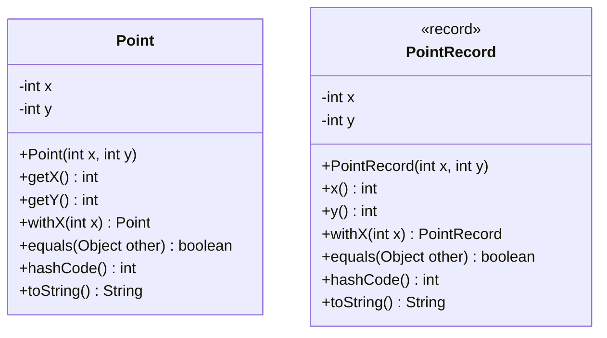

# Inmutabilidad: controlar los cambios en el estado

[Documento principal](README.md) · Anterior: [Delegación](Delegation.md)

## Propósito

Comprender las ventajas de conservar estable el estado de un objeto y comparar dos implementaciones: una clase convencional y un `record`. La inmutabilidad es una decisión de diseño independiente del mecanismo utilizado para implementarla.

Un objeto inmutable conserva su estado observable durante toda su vida. Puede ofrecer operaciones, pero una operación que representa un cambio devuelve otro valor sin modificar el original.

## Un ejemplo sencillo: un punto

Un punto representa dos coordenadas enteras. Si varias partes del programa comparten un punto mutable, cualquiera que pueda modificarlo puede cambiar las coordenadas que observan las demás. Para conocer su valor habría que seguir también el historial de modificaciones.

Con un punto inmutable, las coordenadas permanecen estables. Para representar otra posición se crea otro punto. Esto permite compartir el original o conservarlo como una versión anterior sin que una modificación posterior lo altere.

## Encapsulamiento y mutadores

El encapsulamiento protege la representación y las reglas del objeto mediante una API controlada. Los campos privados impiden el acceso directo, pero no convierten al objeto en inmutable.

Este fragmento representa una alternativa **mutable**:

```java
public void setX(int x) {
    this.x = x;
}
```

`setX()` (establecer coordenada x) modifica un objeto existente. Es un mutador, igual que cualquier otra operación que cambie su estado, aunque no tenga el prefijo `set`. Los mutadores son adecuados cuando el dominio requiere que una entidad cambie conservando su identidad; deben mantener sus invariantes.

En las versiones inmutables usaremos `withX()` (con coordenada x): devuelve otro punto y conserva el original. No es un mutador del objeto receptor. El cliente decide si conserva ambos valores o reemplaza una referencia por el nuevo.

**Un objeto mutable bien encapsulado controla sus cambios; uno inmutable impide cambios posteriores de su estado.** Ambas decisiones pueden ser correctas según el requisito.

## Primera implementación: una clase inmutable

La clase `Point` (Punto) tiene campos privados y finales, no expone mutadores y no admite subclases. Como las coordenadas son valores primitivos, no hay objetos internos mutables que proteger.

Se define igualdad por contenido: dos puntos de esta clase son iguales cuando sus coordenadas coinciden. La igualdad y el código hash deben ser coherentes; la inmutabilidad por sí sola no genera esos métodos.

**Archivo: `Point.java`**

```java
public final class Point {
    private final int x;
    private final int y;

    public Point(int x, int y) {
        this.x = x;
        this.y = y;
    }

    public int getX() {
        return x;
    }

    public int getY() {
        return y;
    }

    public Point withX(int x) {
        return new Point(x, y);
    }

    @Override
    public boolean equals(Object other) {
        if (this == other) {
            return true;
        }
        if (!(other instanceof Point point)) {
            return false;
        }
        return x == point.x && y == point.y;
    }

    @Override
    public int hashCode() {
        return 31 * Integer.hashCode(x) + Integer.hashCode(y);
    }

    @Override
    public String toString() {
        return "Point[x=" + x + ", y=" + y + "]";
    }
}
```

El constructor establece el estado y los accesores solo consultan sus valores. `withX()` (con coordenada x) construye otro punto. La clase permite controlar explícitamente la representación, los nombres de los métodos y la semántica de igualdad, a cambio de escribir y mantener más código.

## Segunda implementación: un record

`PointRecord` (Registro de punto) representa los mismos datos. Se usa otro nombre para permitir comparar ambas implementaciones en el mismo ejemplo.

**Archivo: `PointRecord.java`**

```java
public record PointRecord(int x, int y) {
    public PointRecord withX(int x) {
        return new PointRecord(x, y);
    }
}
```

El `record` genera el constructor canónico, los accesores `x()` (coordenada x) y `y()` (coordenada y), y los métodos de igualdad, código hash y representación textual basados en sus componentes. Los campos de los componentes son privados y finales, y el tipo no admite subclases.

La operación `withX()` (con coordenada x) sigue siendo una decisión del diseño: el `record` no genera operaciones para crear versiones modificadas.

## Comparación de uso

**Archivo: `Test.java`**

```java
public class Test {
    public static void main(String[] args) {
        Point original = new Point(2, 3);
        Point updated = original.withX(5);

        System.out.println(original);
        System.out.println(updated);
        System.out.println(original.equals(new Point(2, 3)));

        PointRecord originalRecord = new PointRecord(2, 3);
        PointRecord updatedRecord = originalRecord.withX(5);

        System.out.println(originalRecord);
        System.out.println(updatedRecord);
        System.out.println(originalRecord.equals(new PointRecord(2, 3)));
    }
}
```

Salida esperada:

```text
Point[x=2, y=3]
Point[x=5, y=3]
true
PointRecord[x=2, y=3]
PointRecord[x=5, y=3]
true
```

Ambas implementaciones conservan el original y generan otro valor con la nueva coordenada. La comparación por contenido se realiza entre objetos del mismo tipo: un `Point` (Punto) y un `PointRecord` (Registro de punto) no son iguales entre sí por tener las mismas coordenadas. Tampoco se utiliza `==` para comparar su contenido, porque comprueba identidad de referencias.

### Diagrama de clases



Son alternativas independientes, sin relación de herencia entre ellas. En el `record` se muestran también los métodos generados para comparar las APIs resultantes.

## Diferencias, ventajas y límites

| Aspecto | Clase convencional | Record |
| --- | --- | --- |
| Código necesario | Hay que escribir campos, constructor y métodos. | Genera la estructura habitual de un valor a partir de sus componentes. |
| Igualdad por contenido | Debe implementarse si se necesita. | Se genera a partir de los componentes; puede redefinirse respetando su contrato. |
| Representación y API | Permite separar los datos internos de la API pública. | Los componentes determinan el constructor canónico y los accesores públicos. |
| Estado de instancia | Puede definir los campos que necesite el diseño. | No permite campos de instancia adicionales a los de sus componentes. |
| Herencia | Puede extender otra clase y decidir si admite subclases. | No puede extender una clase elegida por el programador ni admitir subclases. |
| Interfaces y operaciones | Puede implementar interfaces y definir comportamiento. | También puede implementar interfaces y definir comportamiento. |
| Inmutabilidad | Debe diseñarse y protegerse explícitamente. | Sus componentes finales no garantizan inmutabilidad profunda. |

El `record` reduce código repetitivo y es una buena opción cuando el valor se describe mediante sus componentes. La clase convencional ofrece más control sobre representación, API y extensión. En el punto, ambas alternativas son inmutables; la diferencia principal está en cómo expresan y mantienen ese diseño.

## Lo que un record no resuelve automáticamente

El punto utiliza únicamente enteros. Si un objeto contiene listas u otros objetos mutables, declarar sus referencias finales impide reasignarlas, pero no impide modificar los objetos referenciados. Esto afecta tanto a clases convencionales como a `record`.

Para proteger ese estado hay que revisar las referencias que entran por el constructor y las que salen por los accesores. Según el caso, se necesitan copias defensivas y elementos inmutables. Una vista no modificable puede seguir reflejando cambios de la colección original; una copia superficial puede seguir compartiendo elementos mutables.

Por tanto, **ni campos privados, ni ausencia de setters, ni referencias finales bastan por separado**. La inmutabilidad depende de que no existan vías para alterar el estado observable del objeto.

## ¿Qué ventajas aporta la inmutabilidad?

- **Razonamiento más sencillo:** un punto conserva sus coordenadas durante una operación, aunque otros clientes lo compartan.
- **Conservación de valores anteriores:** una nueva posición no destruye la anterior; ambas pueden coexistir.
- **Invariantes estables:** las reglas establecidas en la construcción no pueden romperse mediante cambios posteriores del estado.
- **Pruebas predecibles:** se comprueba el resultado de una operación y que el valor original permanece igual.
- **Claves estables:** con igualdad y código hash por contenido, el estado utilizado al almacenar una clave no cambia después.
- **Menos interferencia entre tareas concurrentes:** compartir estos valores no permite carreras que modifiquen sus coordenadas. Aún hay que coordinar otras operaciones compartidas y el reemplazo de referencias cuando corresponda.

## Cuándo conviene y qué cuesta

La inmutabilidad resulta útil para coordenadas, configuraciones, resultados y otros valores que deben permanecer estables o compartirse sin modificaciones. Crear nuevas versiones puede requerir más objetos y copias; el costo depende del tamaño de los datos y de la frecuencia de los cambios.

No exige eliminar los mutadores de todo el sistema. Una entidad con identidad y ciclo de vida puede ser mutable y mantener valores internos inmutables. Por ejemplo, un objeto que representa un personaje puede cambiar su referencia a la posición actual sin modificar los puntos que otras partes del programa conservan.

La decisión se toma en dos pasos: primero determinar si el estado debe cambiar o conservarse; después elegir una clase convencional o un `record` según la semántica del objeto y las necesidades de su API.

## Comprobación conceptual

- ¿Por qué un punto con campos privados y un mutador seguiría siendo mutable?
- ¿Qué cambia al reemplazar una referencia por otro punto y qué permanece intacto?
- ¿Qué código elimina el `record` y qué decisiones siguen siendo responsabilidad del diseño?
- ¿Por qué un `record` con una lista mutable no tiene las mismas garantías que el punto del ejemplo?
- ¿Cuándo convendría una clase convencional aunque el objeto fuera inmutable?
