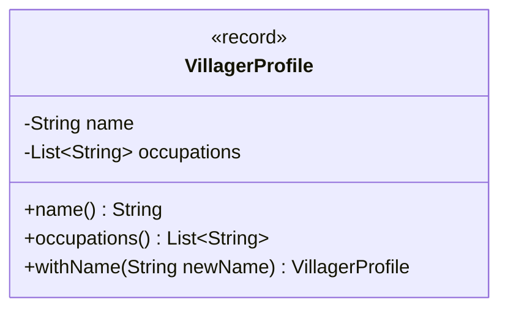

# Inmutabilidad: controlar los cambios en el estado

[Documento principal](README.md) · Anterior: [Delegación](Delegation.md)

## Propósito

Decidir qué información debe permanecer estable después de construir un objeto y cómo protegerla. Herencia, interfaces, composición y delegación organizan tipos y comportamiento; la mutabilidad aborda otra dimensión: los cambios observables del estado.

Un objeto inmutable conserva su estado observable durante toda su vida. Una operación que representa un cambio puede devolver un nuevo valor, dejando intacto el anterior.

## Referencias, objetos y colecciones

| Mecanismo | Garantía | Límite |
| --- | --- | --- |
| Campo `final` | La referencia o valor del campo no se reasigna tras su inicialización | El objeto referenciado puede seguir cambiando |
| Clase `final` | No admite subclases | Sus instancias pueden ser mutables |
| Ausencia de setters | No hay esos métodos de modificación | Puede haber otras vías de modificación o referencias expuestas |
| Vista no modificable | No permite modificar la colección a través de esa vista | Puede reflejar cambios realizados sobre la colección original |
| Copia defensiva | Separa el estado de las referencias externas copiadas | Una copia superficial conserva referencias a los mismos elementos |
| `record` | Define componentes con campos finales y semántica de valor generada | No garantiza inmutabilidad profunda de sus componentes |

La protección debe considerar tanto las referencias que entran por el constructor como las que salen por métodos de acceso.

## Un perfil como valor inmutable

El perfil describe un nombre y los nombres de sus oficios. No contiene los colaboradores que ejecutan actividades: separar estos datos evita confundir una descripción estable con un sistema de comportamientos.

Ejemplo completo para Java 17+, en una carpeta independiente.

**Archivo: `VillagerProfile.java`**

```java
import java.util.List;
import java.util.Objects;

public record VillagerProfile(String name, List<String> occupations) {
    public VillagerProfile {
        Objects.requireNonNull(name, "name");
        if (name.isBlank()) {
            throw new IllegalArgumentException("El nombre no puede estar vacío");
        }
        occupations = List.copyOf(Objects.requireNonNull(occupations, "occupations"));
        if (occupations.stream().anyMatch(String::isBlank)) {
            throw new IllegalArgumentException("Los oficios no pueden estar vacíos");
        }
    }

    public VillagerProfile withName(String newName) {
        return new VillagerProfile(newName, occupations);
    }
}
```

**Archivo: `Main.java`**

```java
import java.util.ArrayList;
import java.util.List;

public class Main {
    public static void main(String[] args) {
        List<String> occupations = new ArrayList<>(List.of("agricultura"));
        VillagerProfile original = new VillagerProfile("Ana", occupations);
        occupations.add("pesca");
        VillagerProfile renamed = original.withName("Lucía");

        System.out.println(original.name() + ": " + original.occupations());
        System.out.println(renamed.name() + ": " + renamed.occupations());
        System.out.println(original.equals(
                new VillagerProfile("Ana", List.of("agricultura"))));

        try {
            original.occupations().add("caza");
        } catch (UnsupportedOperationException exception) {
            System.out.println("La lista del perfil no admite modificaciones");
        }
    }
}
```

Salida esperada:

```text
Ana: [agricultura]
Lucía: [agricultura]
true
La lista del perfil no admite modificaciones
```

El constructor compacto valida los argumentos antes de que se asignen a los campos del `record`. `List.copyOf` obtiene una lista no modificable que no refleja modificaciones posteriores de la lista original y rechaza elementos nulos. También se rechazan nombres y oficios en blanco; una lista vacía y los oficios repetidos se permiten en este ejemplo.

La copia es superficial. Aquí es suficiente porque sus elementos son `String`, que es inmutable. Si los elementos fueran objetos mutables, habría que utilizar valores inmutables o copiar y proteger también su estado. `List.copyOf` puede reutilizar una lista que ya sea adecuada; la garantía relevante es su comportamiento, no crear siempre otra instancia.

`withName()` construye un nuevo perfil y aplica de nuevo las validaciones. Los accesores del `record` se llaman `name()` y `occupations()`. La igualdad generada utiliza los valores de sus componentes; no se utiliza `==` para comparar perfiles por contenido.

### Diagrama del perfil inmutable

`VillagerProfile` (Perfil de aldeano) representa datos, no capacidades de trabajo. Se muestran sus componentes y accesores; `withName()` (con nombre) devuelve otro perfil sin modificar el original.



La inmutabilidad depende también de cómo se protegen los datos: en este ejemplo, los nombres son cadenas inmutables y la lista de oficios se copia mediante `List.copyOf()` (copia de lista). El diagrama por sí solo no garantiza esa propiedad.

## Alternativa con una clase convencional

Un `record` resulta apropiado para datos cuyo significado se expresa mediante sus componentes. Una clase convencional permite controlar de otra manera la representación y la API.

Para diseñarla como inmutable se deben establecer invariantes en el constructor, evitar modificaciones posteriores, proteger referencias mutables de entrada y salida, y controlar la extensión de la clase, por ejemplo declarándola `final`. Los campos `private final` ayudan a expresar esa intención, pero no sustituyen el análisis de los objetos referenciados.

No se debe declarar inmutable el `Villager` de la etapa de delegación solo por tener referencias finales. Sus colaboradores podrían conservar estado mutable o producir efectos externos; habría que revisar sus contratos e implementaciones.

## Cuándo conviene y qué cuesta

La inmutabilidad facilita compartir valores, mantener un estado estable al razonar sobre una operación y utilizar claves cuyo `equals()` y `hashCode()` no cambien. También reduce ciertos riesgos de estado compartido en concurrencia, aunque no resuelve por sí sola la coordinación de operaciones ni todos los problemas de publicación entre hilos.

Representar cada actualización con un valor nuevo puede aumentar las asignaciones y las copias. Entidades con identidad y ciclos de vida cambiantes pueden necesitar mutabilidad controlada. Es posible combinar una entidad mutable con valores internos inmutables y operaciones que protejan sus invariantes.

## Comprobación conceptual

- ¿Por qué modificar la lista original no cambia el perfil?
- ¿Qué dejaría de estar protegido si los elementos fueran objetos mutables?
- ¿Qué diferencia existe entre renombrar una entidad y crear una nueva versión de un valor?
- ¿Qué decisiones sobre estado siguen siendo necesarias aunque el comportamiento se organice mediante interfaces?

La ruta permite evaluar conjuntamente contratos, colaboradores, distribución del trabajo y control del estado. Cada mecanismo responde a un requisito concreto y puede combinarse con los demás sin abandonar automáticamente la herencia.
