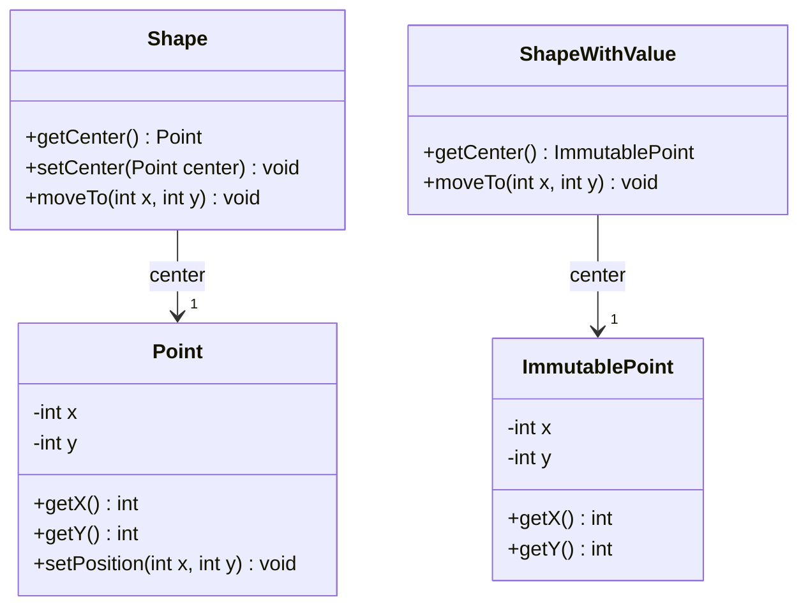
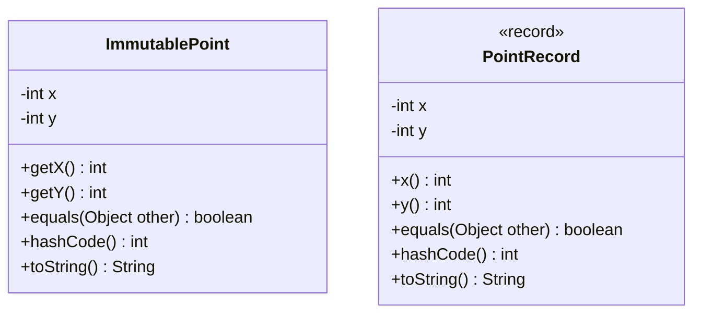

# Inmutabilidad: controlar los cambios en el estado

[Documento principal](README.md) · Anterior: [Delegación](Delegation.md)

## Propósito

Comprender la mutabilidad y la inmutabilidad como decisiones de diseño. Primero se presenta una clase mutable, después una clase convencional inmutable y finalmente un `record` como alternativa para expresar ciertos valores con menos código.

## Mutabilidad e inmutabilidad

Un objeto es **mutable** si su estado observable puede cambiar después de construirse. Un mutador modifica el mismo objeto; todas las referencias a ese objeto permiten observar el cambio. Los setters son una forma de mutador, pero también lo son otras operaciones que alteran el estado.

Un objeto es **inmutable** si su estado observable permanece estable durante toda su vida. Puede ofrecer operaciones: cuando estas representan un cambio, pueden devolver otro objeto sin modificar el original.

Reemplazar una referencia no es modificar el objeto al que apuntaba. Una figura puede cambiar su posición asignándose otro punto, mientras el punto anterior permanece intacto. Así, una entidad mutable puede contener valores inmutables.

La inmutabilidad no depende de `record`. Una clase convencional puede diseñarse como mutable o inmutable. El `record` es una herramienta de Java para expresar valores mediante componentes; sus garantías deben analizarse según los datos que contiene.

## Primera versión: un punto mutable dentro de una figura

`Point` (Punto) permite modificar sus coordenadas. `Shape` (Figura) guarda un punto como centro y lo devuelve mediante un getter. Para modificar ambas coordenadas usamos `setPosition()` (establecer posición), en lugar de un setter de una sola coordenada.

**Archivo: `Point.java`**

```java
public class Point {
    private int x;
    private int y;

    public Point() {
        this(0, 0);
    }

    public Point(int x, int y) {
        this.x = x;
        this.y = y;
    }

    public int getX() {
        return x;
    }

    public int getY() {
        return y;
    }

    public void setPosition(int x, int y) {
        this.x = x;
        this.y = y;
    }
}
```

**Archivo: `Shape.java`**

```java
public class Shape {
    private Point center;

    public Shape() {
        this(new Point());
    }

    public Shape(Point center) {
        this.center = center;
    }

    public Point getCenter() {
        return center;
    }

    public void setCenter(Point center) {
        this.center = center;
    }

    public void moveTo(int x, int y) {
        center.setPosition(x, y);
    }
}
```

El siguiente recorrido es válido y desplaza el centro hasta la posición `(99, 99)`:

```java
Shape shape = new Shape();
for (int step = 0; step < 100; step += 1) {
    shape.getCenter().setPosition(step, step);
}
```

**No necesitamos un `record` para que este desplazamiento funcione.** Si nadie más comparte el punto y se acepta que el cliente lo modifique directamente, esta solución puede ser suficiente.

## El problema aparece al compartir el punto

El campo privado no basta para proteger el centro: `getCenter()` (obtener centro) devuelve la misma referencia mutable. El cliente puede modificar la figura sin llamar a una operación de la propia figura.

Además, dos figuras pueden recibir el mismo punto. Desplazar una modifica también el centro de la otra. Una referencia guardada como «posición anterior» tampoco conserva una instantánea: sigue apuntando al objeto que cambia.

Esto es un problema si las figuras deben moverse independientemente o si necesitamos conservar posiciones anteriores. Si compartir deliberadamente una posición móvil fuera el requisito, ese mismo comportamiento podría ser correcto.

## Segunda versión: una clase convencional inmutable

`ImmutablePoint` (Punto inmutable) representa las mismas coordenadas sin permitir modificaciones posteriores. No se utiliza un `record`.

**Archivo: `ImmutablePoint.java`**

```java
public final class ImmutablePoint {
    private final int x;
    private final int y;

    public ImmutablePoint(int x, int y) {
        this.x = x;
        this.y = y;
    }

    public int getX() {
        return x;
    }

    public int getY() {
        return y;
    }

    @Override
    public boolean equals(Object other) {
        if (this == other) {
            return true;
        }
        if (!(other instanceof ImmutablePoint point)) {
            return false;
        }
        return x == point.x && y == point.y;
    }

    @Override
    public int hashCode() {
        return 31 * Integer.hashCode(x) + Integer.hashCode(y);
    }

    @Override
    public String toString() {
        return "ImmutablePoint[x=" + x + ", y=" + y + "]";
    }
}
```

La inmutabilidad se obtiene mediante decisiones que actúan juntas:

- Los campos privados impiden que el cliente los modifique directamente.
- Los campos finales no pueden reasignarse después de su inicialización.
- No hay setters ni otras operaciones que modifiquen el punto.
- La clase final impide introducir subclases que alteren estas garantías.
- Sus componentes son enteros; no hay referencias internas a objetos mutables que puedan escapar.

La igualdad por coordenadas, el código hash y la representación textual se implementan explícitamente. Son características útiles de un valor, pero no son las que lo hacen inmutable.

### Una figura mutable con un centro inmutable

`ShapeWithValue` (Figura con valor) conserva un punto inmutable. Para desplazarla reemplaza su referencia al centro por otro punto.

**Archivo: `ShapeWithValue.java`**

```java
public class ShapeWithValue {
    private ImmutablePoint center;

    public ShapeWithValue() {
        this(new ImmutablePoint(0, 0));
    }

    public ShapeWithValue(ImmutablePoint center) {
        this.center = center;
    }

    public ImmutablePoint getCenter() {
        return center;
    }

    public void moveTo(int x, int y) {
        center = new ImmutablePoint(x, y);
    }
}
```

La figura sigue siendo mutable: su centro actual cambia. El punto permanece inmutable. Podemos devolverlo sin permitir que el cliente altere sus coordenadas; para cambiar la posición de la figura hay que utilizar su operación `moveTo()` (mover a).

```java
ShapeWithValue shape = new ShapeWithValue();
for (int step = 0; step < 100; step += 1) {
    shape.moveTo(step, step);
}
```

Cada iteración crea otro valor. Los puntos anteriores permanecen intactos si alguien conserva sus referencias.

## Demostración: dos figuras y una posición anterior

**Archivo: `Test.java`**

```java
public class Test {
    public static void main(String[] args) {
        Point sharedPoint = new Point(0, 0);
        Shape first = new Shape(sharedPoint);
        Shape second = new Shape(sharedPoint);
        Point previous = first.getCenter();

        first.getCenter().setPosition(10, 20);

        System.out.println("Mutable second: "
                + second.getCenter().getX() + ", " + second.getCenter().getY());
        System.out.println("Mutable previous: "
                + previous.getX() + ", " + previous.getY());

        ImmutablePoint sharedValue = new ImmutablePoint(0, 0);
        ShapeWithValue firstValue = new ShapeWithValue(sharedValue);
        ShapeWithValue secondValue = new ShapeWithValue(sharedValue);
        ImmutablePoint previousValue = firstValue.getCenter();

        firstValue.moveTo(10, 20);

        System.out.println("Value first: " + firstValue.getCenter());
        System.out.println("Value second: " + secondValue.getCenter());
        System.out.println("Value previous: " + previousValue);
    }
}
```

Salida esperada:

```text
Mutable second: 10, 20
Mutable previous: 10, 20
Value first: ImmutablePoint[x=10, y=20]
Value second: ImmutablePoint[x=0, y=0]
Value previous: ImmutablePoint[x=0, y=0]
```

En la primera versión, se modificó un objeto compartido: cambió la otra figura y se perdió la supuesta posición anterior. En la segunda, solo se reemplazó la referencia de la primera figura. La otra figura y el punto anterior conservaron sus valores.

### Diagrama de clases



## Encapsulamiento y mutadores

Encapsular significa controlar cómo se consulta y modifica el estado, no solo declarar campos privados. En la primera versión, el getter deja escapar una referencia mutable y permite evitar la API de movimiento de la figura. Cualquier validación o actualización adicional situada en esa API podría omitirse.

También puede protegerse una figura **sin usar un `record`**: copiar el punto recibido, devolver copias defensivas y ofrecer operaciones controladas para moverla. Hay que proteger tanto las referencias de entrada como las de salida. La segunda versión muestra precisamente la alternativa de una clase convencional inmutable.

Un mutador es cualquier método que cambia un objeto existente, no únicamente un setter. En estos ejemplos, `setPosition()` (establecer posición), `setCenter()` (establecer centro) y ambos métodos `moveTo()` (mover a) son mutadores de sus respectivos objetos. Reemplazar un centro inmutable no vuelve inmutable a la figura.

La segunda versión elimina los mutadores del **valor punto**, no los de la entidad figura. Esa combinación permite que una entidad evolucione mientras los valores compartidos o conservados como historial permanecen estables.

## Tercera versión: record como alternativa más breve

La clase convencional ya resolvió el problema de los valores compartidos. Ahora podemos evaluar un `record` para reducir el código necesario al representar el mismo valor.

**Archivo: `PointRecord.java`**

```java
public record PointRecord(int x, int y) {
}
```

`PointRecord` (Registro de punto) genera el constructor canónico, campos privados y finales, accesores, igualdad y código hash por componentes y representación textual. En la clase anterior escribimos esos elementos explícitamente. Los accesores del `record` se llaman `x()` (coordenada x) e `y()` (coordenada y), en lugar de usar el prefijo de los getters.

También es un tipo final y puede definir operaciones e implementar interfaces. No puede extender una clase elegida por el programador ni declarar campos de instancia adicionales a sus componentes.

### Uso equivalente

**Archivo: `RecordTest.java`**

```java
public class RecordTest {
    public static void main(String[] args) {
        ImmutablePoint original = new ImmutablePoint(0, 0);
        ImmutablePoint updated = new ImmutablePoint(10, 20);
        System.out.println(original);
        System.out.println(updated);
        System.out.println(original.equals(new ImmutablePoint(0, 0)));

        PointRecord originalRecord = new PointRecord(0, 0);
        PointRecord updatedRecord = new PointRecord(10, 20);
        System.out.println(originalRecord);
        System.out.println(updatedRecord);
        System.out.println(originalRecord.equals(new PointRecord(0, 0)));
    }
}
```

Salida esperada:

```text
ImmutablePoint[x=0, y=0]
ImmutablePoint[x=10, y=20]
true
PointRecord[x=0, y=0]
PointRecord[x=10, y=20]
true
```

Ambas versiones mantienen estable el original y permiten representar otra posición con otro objeto. Las comparaciones se realizan entre objetos del mismo tipo; no hay igualdad entre los dos tipos distintos por tener las mismas coordenadas.

Podríamos adaptar la figura para guardar `PointRecord` (Registro de punto) en lugar de `ImmutablePoint` (Punto inmutable) y construir ese tipo en su operación de movimiento. No cambiaría la estrategia: reemplazar la referencia en lugar de modificar el punto.

### Diagrama de las dos alternativas inmutables



Son alternativas independientes, sin relación de herencia entre ellas. El diagrama muestra también los métodos generados del `record`.

### Comparación de las tres versiones

| Alternativa | Ventaja | Costo o límite |
| --- | --- | --- |
| Punto mutable | Permite actualizar el mismo objeto. | Las referencias compartidas observan los cambios; exige controlar quién puede modificarlo. |
| Clase convencional inmutable | Valores estables con control de representación y API. | Requiere escribir constructor, accesores y los métodos de valor que se necesiten. |
| Record con coordenadas enteras | Las mismas garantías de estabilidad con menos código repetitivo y métodos de valor generados. | Sus componentes determinan su API pública y restringe la representación y la herencia. |

Crear nuevos valores al cambiar de posición es una consecuencia del diseño inmutable, tanto con una clase como con un `record`. La clase convencional ofrece más libertad para ocultar la representación y diseñar su API. El `record` resulta adecuado cuando el valor se describe naturalmente mediante sus componentes.

## Ventajas y límites de los valores inmutables

Las ventajas visibles en el ejemplo son compartir posiciones sin interferencia, conservar valores anteriores y concentrar los cambios de la figura en su propia API. Además, los valores estables facilitan razonar sobre operaciones, conservar invariantes y usar claves cuyo estado no cambie después de almacenarlas en una colección.

La contrapartida es crear nuevos valores y, cuando hay estructuras mayores, realizar posibles copias. En un recorrido de muchas actualizaciones ese costo merece evaluarse según el uso real. La mutabilidad controlada puede ser adecuada para estructuras que cambian con mucha frecuencia.

Un `record` no garantiza inmutabilidad profunda: si un componente contiene una lista mutable, el cliente puede modificarla si no se protege. Los componentes finales solo impiden reasignar sus campos. El punto del ejemplo evita ese problema al contener únicamente enteros.

Compartir puntos inmutables evita modificaciones concurrentes de sus coordenadas, pero la figura mutable todavía necesita coordinación si varias tareas actualizan su centro. La inmutabilidad de los valores no resuelve todos los problemas del objeto que los contiene.

## Comprobación conceptual

- ¿Por qué cambia el centro de la segunda figura en la primera versión?
- ¿Por qué una referencia al punto mutable no conserva una posición anterior?
- ¿Cómo protegerías la figura manteniendo una clase de punto mutable?
- ¿Por qué la figura que utiliza un punto inmutable sigue siendo mutable?
- ¿Qué decisiones hacen inmutable a la clase convencional y qué código permite omitir el `record`?
