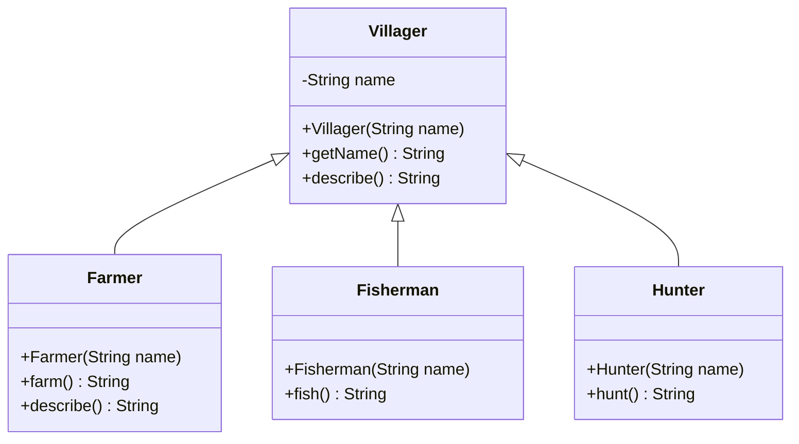

# Herencia: especialización y límites de las jerarquías

[Documento principal](README.md) · Siguiente: [Interfaces](Interfaces.md)

## Propósito

Examinar la herencia como relación de especialización y reconocer cuándo una jerarquía deja de representar adecuadamente los requisitos. La herencia permite compartir implementación y establecer subtipos, pero ambas decisiones deben justificarse por separado.

## Punto de partida: un oficio por aldeano

### Descripción del problema

Se necesita representar los habitantes de una aldea y las actividades que realizan. Todos los aldeanos tienen un nombre y pueden proporcionar una descripción de sí mismos. En el planteamiento inicial, cada aldeano tiene un único oficio: agricultura, pesca o caza, con una operación específica para realizar su actividad.

Como los tres oficios comparten los datos y el comportamiento general de un aldeano, se propone una clase base `Villager` y una subclase por oficio. Esta jerarquía reúne lo común en la superclase y sitúa las operaciones particulares en cada especialización. El supuesto de un único oficio permite comenzar con una solución sencilla; más adelante se examina qué ocurre cuando una misma persona necesita desempeñar varios.

Un `Farmer` es un `Villager` especializado. Hereda el nombre y proporciona una operación propia. Lo mismo ocurre con `Fisherman` y `Hunter`.

### Diagrama de clases



El triángulo vacío apunta a la superclase `Villager`. El signo `-` indica acceso privado y `+` acceso público. Las subclases heredan los métodos públicos; el campo `name` permanece encapsulado en `Villager`. `Farmer` sobrescribe `describe()`, por lo que el método aparece también en esa clase.

En el código, `name` es `final` y las tres subclases son `final`: el nombre no se reasigna después de la construcción y esas subclases no admiten nuevas extensiones. Se omite `Main` porque solo ejecuta el ejemplo y no forma parte de la jerarquía.

### Implementación en Java

El siguiente ejemplo es completo. Guardar cada bloque en el archivo indicado, dentro de una carpeta independiente para esta etapa.

**Archivo: `Villager.java`**

```java
import java.util.Objects;

public class Villager {
    private final String name;

    public Villager(String name) {
        this.name = Objects.requireNonNull(name, "name");
        if (name.isBlank()) {
            throw new IllegalArgumentException("El nombre no puede estar vacío");
        }
    }

    public String getName() {
        return name;
    }

    public String describe() {
        return "Aldeano: " + name;
    }
}
```

**Archivo: `Farmer.java`**

```java
public final class Farmer extends Villager {
    public Farmer(String name) {
        super(name);
    }

    public String farm() {
        return getName() + " cultiva";
    }

    @Override
    public String describe() {
        return super.describe() + " (agricultura)";
    }
}
```

**Archivo: `Fisherman.java`**

```java
public final class Fisherman extends Villager {
    public Fisherman(String name) {
        super(name);
    }

    public String fish() {
        return getName() + " pesca";
    }
}
```

**Archivo: `Hunter.java`**

```java
public final class Hunter extends Villager {
    public Hunter(String name) {
        super(name);
    }

    public String hunt() {
        return getName() + " caza";
    }
}
```

**Archivo: `Main.java`**

```java
public class Main {
    public static void main(String[] args) {
        Farmer farmer = new Farmer("Ana");
        Villager villager = farmer;
        System.out.println(villager.describe());
        System.out.println(farmer.farm());
    }
}
```

Compilar y ejecutar desde la carpeta del ejemplo:

```sh
javac --release 17 *.java
java Main
```

Salida esperada:

```text
Aldeano: Ana (agricultura)
Ana cultiva
```

`describe()` muestra polimorfismo: aunque la variable tiene tipo `Villager`, se ejecuta la implementación de `Farmer`. En cambio, `villager.farm()` no compila porque el contrato de `Villager` no incluye esa operación. El constructor de la subclase llama al de la superclase; los constructores no se heredan.

## El requisito que tensiona el diseño

¿Qué ocurre si Ana también pesca? Java permite extender una sola clase. No es posible declarar una clase que extienda simultáneamente `Farmer` y `Fisherman`; además, ambas son `final` en este ejemplo, pues no se prevén nuevas especializaciones.

Quitar `final` y hacer que un pescador herede de un agricultor tampoco expresa una relación de especialización válida: pescar no implica cultivar. Crear clases para cada combinación de oficios hace crecer la jerarquía y puede duplicar operaciones.

Agregar todos los métodos a `Villager` también tiene un costo: obligaría a representar capacidades que algunos aldeanos no poseen. Implementarlas lanzando excepciones por “oficio no disponible” debilitaría un contrato que prometiera que todos pueden realizar esas acciones.

## Cuándo conservar la herencia

Una subclase resulta razonable cuando mantiene las expectativas del tipo base: sus operaciones aceptan los usos válidos del contrato y conservan sus garantías. Una relación verbal «es un» ayuda a formular la hipótesis, pero no demuestra por sí sola que exista sustitución correcta.

| Situación | Criterio de decisión |
| --- | --- |
| Especialización estable con contrato común | La herencia puede ser apropiada |
| Solo se necesita reutilizar un algoritmo | Evaluar un colaborador antes de crear un subtipo |
| Las capacidades se combinan independientemente | Evaluar interfaces y composición |
| Un cambio en la base rompe muchas subclases | Revisar el acoplamiento con la implementación heredada |

La herencia no es el problema en sí misma: el problema aparece cuando se usa una única dimensión de especialización para representar capacidades independientes.

## Comprobación conceptual

- ¿Qué garantiza `Villager` a cualquier cliente?
- ¿Por qué un aldeano que pesca y cultiva no necesita representar una nueva especie de aldeano?
- ¿Qué parte del diseño corresponde a un contrato y qué parte solo reutiliza implementación?

La siguiente etapa introduce [interfaces](Interfaces.md) para expresar varias capacidades sin heredar de varias clases.
