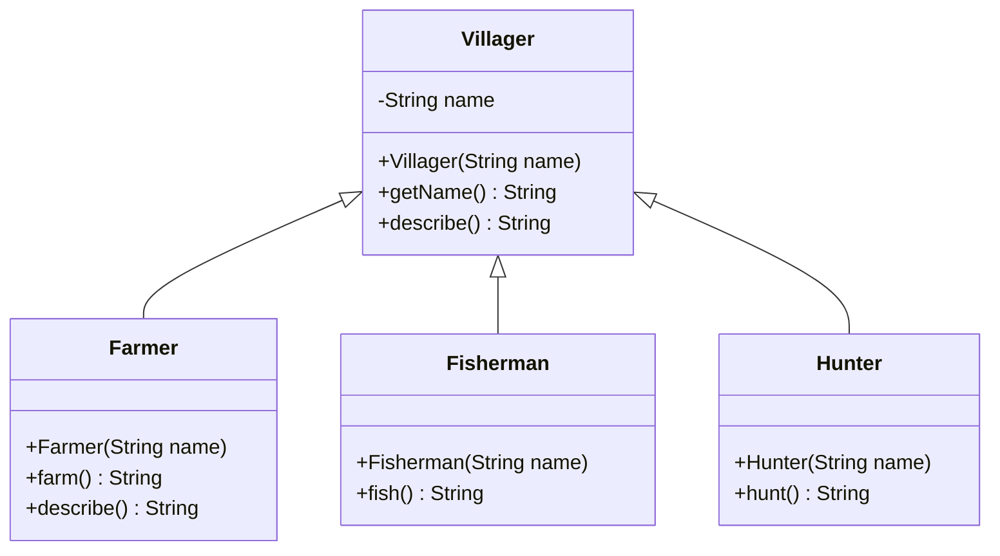

# Herencia: especialización y límites de las jerarquías

[Documento principal](README.md) · Siguiente: [Interfaces](Interfaces.md)

## Propósito

Examinar la herencia como relación de especialización y reconocer cuándo una jerarquía deja de representar adecuadamente los requisitos. La herencia permite compartir implementación y establecer subtipos, pero ambas decisiones deben justificarse por separado.

## Herencia simple: el diseño inicial

### Descripción del problema

Se necesita representar los habitantes de una aldea y las actividades que realizan. Todos los aldeanos tienen un nombre y pueden proporcionar una descripción de sí mismos. En el planteamiento inicial, cada aldeano tiene un único oficio: agricultura, pesca o caza, con una operación específica para realizar su actividad.

Como los tres oficios comparten los datos y el comportamiento general de un aldeano, se propone una clase base `Villager` y una subclase por oficio. Esta jerarquía reúne lo común en la superclase y sitúa las operaciones particulares en cada especialización. El supuesto de un único oficio permite comenzar con una solución sencilla; más adelante se examina qué ocurre cuando una misma persona necesita desempeñar varios.

Un `Villager` (Aldeano) representa una persona de la aldea. `Farmer` (Agricultor), `Fisherman` (Pescador) y `Hunter` (Cazador) son especializaciones para el requisito inicial. Cada objeto conserva un nombre y ofrece la actividad de su oficio: `farm()` (cultivar), `fish()` (pescar) o `hunt()` (cazar).

El modelo tiene dos responsabilidades diferenciadas: la superclase protege el nombre y ofrece `describe()` (describir); las subclases agregan su actividad. Para mantener el ejemplo centrado en el diseño, las actividades devuelven textos no nulos: no modifican cosechas, peces ni inventarios. La presentación en consola pertenece al programa de prueba, no a las clases del dominio.

### Diagrama de clases



### Implementación en Java

La clase base reúne el nombre y la descripción general; cada especialización agrega la actividad de su oficio.

**Archivo: `Villager.java`**

```java
import java.util.Objects;

public class Villager {
    private final String name;

    public Villager(String name) {
        this.name = Objects.requireNonNull(name, "name");
        if (name.isBlank()) {
            throw new IllegalArgumentException("El nombre no puede estar vacío");
        }
    }

    public String getName() {
        return name;
    }

    public String describe() {
        return "Aldeano: " + name;
    }
}
```

**Archivo: `Farmer.java`**

```java
public class Farmer extends Villager {
    public Farmer(String name) {
        super(name);
    }

    public String farm() {
        return getName() + " cultiva";
    }

    @Override
    public String describe() {
        return super.describe() + " (agricultura)";
    }
}
```

**Archivo: `Fisherman.java`**

```java
public class Fisherman extends Villager {
    public Fisherman(String name) {
        super(name);
    }

    public String fish() {
        return getName() + " pesca";
    }
}
```

**Archivo: `Hunter.java`**

```java
public class Hunter extends Villager {
    public Hunter(String name) {
        super(name);
    }

    public String hunt() {
        return getName() + " caza";
    }
}
```

**Archivo: `Test.java`**

```java
public class Test {
    public static void main(String[] args) {
        Villager villager = new Villager("Elena");
        Farmer farmer = new Farmer("Ana");
        Fisherman fisherman = new Fisherman("Luis");
        Hunter hunter = new Hunter("Sara");

        Villager[] villagers = {villager, farmer, fisherman, hunter};
        for (Villager current : villagers) {
            System.out.println(current.describe());
        }

        System.out.println(farmer.farm());
        System.out.println(fisherman.fish());
        System.out.println(hunter.hunt());

        Villager specializedVillager = farmer;
        if (!specializedVillager.describe().equals("Aldeano: Ana (agricultura)")) {
            throw new AssertionError("Unexpected description");
        }
    }
}
```

Salida esperada:

```text
Aldeano: Elena
Aldeano: Ana (agricultura)
Aldeano: Luis
Aldeano: Sara
Ana cultiva
Luis pesca
Sara caza
```

### Qué demuestra el programa

- **Construcción:** `super(name)` invoca el constructor de la superclase y establece el nombre. Los constructores no se heredan.
- **Encapsulamiento:** el campo `name` (nombre) es privado; las subclases lo consultan mediante `getName()` (obtener nombre), sin acceder directamente al campo.
- **Extensión:** cada oficio agrega una operación sin repetir el almacenamiento ni la validación del nombre.
- **Sobrescritura y polimorfismo:** la variable `specializedVillager` (aldeano especializado) tiene tipo declarado `Villager` (Aldeano), pero referencia el mismo objeto agricultor. Al llamar a `describe()` (describir), se ejecuta la versión de `Farmer` (Agricultor). `@Override` permite al compilador comprobar que se está sobrescribiendo un método existente; `super.describe()` reutiliza la descripción base.

El tipo declarado determina qué operaciones puede solicitar el código cliente. Por eso `specializedVillager.farm()` no compila: `Villager` (Aldeano) no declara `farm()` (cultivar), aunque el objeto concreto sea agricultor. No hay conversión ni copia del objeto al asignarlo a una referencia de la superclase.

Las otras dos especializaciones conservan la descripción heredada. Sobrescribir es una decisión de comportamiento, no una obligación para todas las subclases. La clase `Test` (Prueba) muestra los resultados y comprueba explícitamente el despacho polimórfico sin bibliotecas externas.

## Evolución del requisito: un aldeano con dos oficios

Ana ahora debe cultivar y pescar. Se propone `FarmerFisherman` (AgricultorPescador): debe conservar una única identidad y un único nombre, y ofrecer ambas actividades. Crear dos objetos separados, uno por oficio, no expresa por sí solo que se trata de la misma persona.

### El intento de heredar de dos clases

El siguiente fragmento es **deliberadamente inválido** y no debe incluirse entre los archivos del ejemplo ejecutable:

```java
// Invalid: Java does not allow extending two classes.
public class FarmerFisherman extends Farmer, Fisherman {
    public FarmerFisherman(String name) {
        super(name);
    }
}
```

Java permite una sola superclase directa por clase. Por tanto, `FarmerFisherman` (AgricultorPescador) no puede heredar simultáneamente de `Farmer` (Agricultor) y `Fisherman` (Pescador). Esta restricción existe aunque las clases no sean `final`; cerrar una clase con `final` sería una prohibición adicional y distinta.

Herencia simple tampoco significa un único nivel: se pueden construir cadenas con varias generaciones, pero cada clase sigue teniendo una sola superclase directa.

### ¿FarmerFisher o FisherFarmer?

Surge entonces una duda: **¿conviene crear `FarmerFisher` (AgricultorPescador), como un agricultor que también pesca, o `FisherFarmer` (PescadorAgricultor), como un pescador que también cultiva?** Son dos posibles formas de nombrar y organizar la combinación antes llamada `FarmerFisherman` (AgricultorPescador).

La diferencia relevante no está en el orden de las palabras, sino en la superclase elegida:

| Alternativa | Qué hereda | Qué debe agregar | Límite de tipado |
| --- | --- | --- | --- |
| `FarmerFisher` (AgricultorPescador) extiende `Farmer` (Agricultor) | La actividad de cultivo | `fish()` (pescar) | Es un subtipo de agricultor, pero no de `Fisherman` (Pescador). |
| `FisherFarmer` (PescadorAgricultor) extiende `Fisherman` (Pescador) | La actividad de pesca | `farm()` (cultivar) | Es un subtipo de pescador, pero no de `Farmer` (Agricultor). |

Ambas alternativas pueden implementarse, pero ninguna hereda las dos implementaciones. Si la actividad agregada se copia de la otra clase, habrá duplicación; invertir la superclase solo cambia qué actividad se duplica y qué tipo pueden aceptar los clientes. El nombre de una clase no establece relaciones de herencia: llamarla agricultor y pescador no basta para que el compilador la reconozca como ambos tipos.

¿El dominio distingue realmente entre un agricultor que pesca y un pescador que cultiva? Si existe un oficio principal con reglas propias, esa diferencia podría justificar modelos distintos. En el requisito actual solo se necesitan dos capacidades, sin prioridad entre ellas. Crear ambas clases introduciría una distinción que el problema no pide; elegir una únicamente para reutilizar su código haría depender el modelo de una conveniencia de implementación.

La pregunta que prepara el siguiente paso es: **¿cómo expresar que un mismo aldeano puede cultivar y pescar sin tener que elegir uno de esos oficios como su única ascendencia de clases?**

### Alternativas dentro de la jerarquía y sus costos

| Intento | Consecuencia |
| --- | --- |
| Hacer que `Fisherman` (Pescador) extienda `Farmer` (Agricultor) | Todos los pescadores serían también agricultores, algo que el dominio no exige. La cadena introduce una relación falsa. |
| Hacer que `FarmerFisherman` (AgricultorPescador) extienda `Farmer` (Agricultor) y copiar `fish()` (pescar) | Puede compilar, pero duplica la implementación de pesca y no convierte al nuevo objeto en un subtipo de `Fisherman` (Pescador). Un cliente que exija ese tipo no puede recibirlo. |
| Crear una subclase de `Villager` (Aldeano) por cada combinación | Puede representar las combinaciones, pero repite actividades y multiplica los lugares que deben cambiar cuando evoluciona un oficio. |
| Agregar todas las actividades a `Villager` (Aldeano) | Promete capacidades que algunos aldeanos no poseen. Devolver mensajes de imposibilidad o lanzar excepciones por oficio ausente debilita un contrato que prometiera realizar esas actividades. |

Con tres oficios existen siete combinaciones no vacías posibles si se necesitan todas; con cuatro serían quince. No es obligatorio crear todas esas clases, pero el crecimiento muestra el costo de usar la jerarquía para cada combinación independiente.

El requisito no demuestra que toda herencia sea incorrecta ni que Java impida modelar varios oficios. Demuestra que **heredar implementación y representar capacidades son decisiones diferentes**: la jerarquía inicial reúne ambas, y deja de resultar cómoda cuando los oficios deben combinarse.

## Cuándo conservar la herencia

Una subclase resulta razonable cuando mantiene las expectativas del tipo base: sus operaciones aceptan los usos válidos del contrato y conservan sus garantías. Una relación verbal «es un» ayuda a formular la hipótesis, pero no demuestra por sí sola que exista sustitución correcta.

| Situación | Criterio de decisión |
| --- | --- |
| Especialización estable con contrato común | La herencia puede ser apropiada |
| Solo se necesita reutilizar un algoritmo | Evaluar un colaborador antes de crear un subtipo |
| Las capacidades se combinan independientemente | Evaluar interfaces y composición |
| Un cambio en la base rompe muchas subclases | Revisar el acoplamiento con la implementación heredada |

La herencia no es el problema en sí misma: el problema aparece cuando se usa una única dimensión de especialización para representar capacidades independientes.

## Comprobación conceptual

- ¿Qué garantiza `Villager` (Aldeano) a cualquier cliente?
- ¿Por qué un aldeano que pesca y cultiva no necesita representar una nueva especie de aldeano?
- ¿Qué parte del diseño corresponde a un contrato y qué parte solo reutiliza implementación?

La siguiente etapa introduce [interfaces](Interfaces.md) para expresar capacidades como contratos independientes: `Farmable` (Capaz de cultivar), `Fishable` (Capaz de pescar) y `Huntable` (Capaz de cazar). Una clase puede implementar varios contratos y seguir extendiendo una sola clase.

Esto permitirá separar «qué puede hacer» un objeto de «de qué clase hereda». Las interfaces no comparten automáticamente la implementación de los oficios ni hacen que las capacidades cambien por instancia durante la ejecución. La reutilización mediante colaboradores se estudia después, en [composición](Composition.md).
