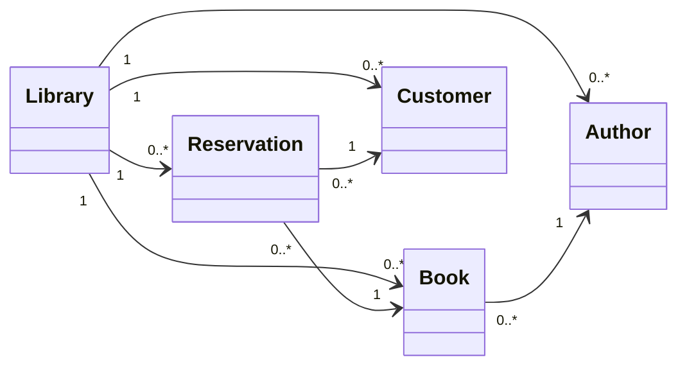

# Asociaciones entre clases en POO: multiplicidad, navegabilidad y relaciones directas e indirectas

## 1. Introducción

En Programación Orientada a Objetos (POO), una **asociación** representa un vínculo entre objetos de diferentes clases. Al interpretar una asociación en un diagrama de clases UML, es importante distinguir dos conceptos:

- **Multiplicidad:** indica cuántos objetos de una clase pueden estar relacionados con un objeto de otra clase.
- **Navegabilidad:** indica desde qué objetos es posible acceder a los objetos relacionados.

Estos conceptos son independientes. Por ejemplo, una asociación uno a muchos (1:N) no implica que ambas clases deban mantener referencias entre sí.

En este documento estudiaremos las asociaciones unidireccionales, su implementación en Java y las relaciones directas e indirectas mediante un ejemplo de biblioteca.

## 2. Ejemplo: sistema de biblioteca

### 2.1. Descripción del problema

Se requiere desarrollar un sistema para gestionar la información de una biblioteca, incluyendo su catálogo de libros, los autores de las obras, los clientes registrados y las reservas realizadas. La biblioteca mantiene un catálogo de libros, cada uno de los cuales tiene un autor, y conserva un registro de autores que puede incluir escritores cuyas obras todavía no forman parte del catálogo. Los clientes pueden registrarse en la biblioteca sin necesidad de realizar una reserva y, cuando desean reservar un libro, el sistema registra la solicitud identificando tanto el libro como el cliente correspondiente. Un mismo cliente puede realizar varias reservas y un libro puede ser reservado en diferentes ocasiones.

### 2.2. Identificación de las asociaciones

A partir de la descripción del problema, se identifican cinco clases: `Library`, `Book`, `Author`, `Customer` y `Reservation`, y se establecen las siguientes condiciones:

1. Cada biblioteca administra cero o muchos libros.
2. Cada biblioteca registra cero o muchos autores, independientemente de que tengan libros en su catálogo.
3. Cada biblioteca administra cero o muchas reservas.
4. Cada biblioteca registra cero o muchos clientes, independientemente de que hayan realizado reservas.
5. Cada libro tiene exactamente un autor.
6. Cada reserva corresponde a exactamente un libro.
7. Cada reserva pertenece a exactamente un cliente.

Para este ejercicio, todas las asociaciones se modelarán como **unidireccionales**, de acuerdo con las necesidades de acceso a los objetos del sistema.

### 2.3. Diagrama de clases UML



*Figura 1. Diagrama de clases UML con cinco clases y siete asociaciones unidireccionales.*

## 3. Interpretación de las asociaciones

Para implementar una asociación unidireccional mediante atributos, debemos identificar:

1. **El origen de la flecha:** determina la clase que mantiene la referencia.
2. **El destino de la flecha:** identifica la clase referenciada.
3. **La multiplicidad en el destino:** permite determinar si necesitamos una referencia individual o una colección.

| Asociación | Multiplicidad en destino | Atributo |
|---|---|---|
| `Library → Book` | 0..* | `List<Book> books` |
| `Library → Author` | 0..* | `List<Author> authors` |
| `Library → Reservation` | 0..* | `List<Reservation> reservations` |
| `Library → Customer` | 0..* | `List<Customer> customers` |
| `Book → Author` | 1 | `Author author` |
| `Reservation → Book` | 1 | `Book book` |
| `Reservation → Customer` | 1 | `Customer customer` |

**Importante:** La multiplicidad en el extremo opuesto también tiene significado, aunque no implique declarar un atributo en esa clase.

Por ejemplo, un autor puede tener muchos libros, pero esto no obliga a declarar `List<Book>` en `Author`.

## 4. Implementación en Java

La implementación muestra únicamente los atributos necesarios para representar las asociaciones. Se omiten constructores, métodos accesores y mutadores para concentrarnos en el concepto estudiado.

**Library.java**

```java
import java.util.List;

public class Library {
    private List<Book> books;
    private List<Author> authors;
    private List<Reservation> reservations;
    private List<Customer> customers;
}
```

**Book.java**

```java
public class Book {
    private Author author;
}
```

**Reservation.java**

```java
public class Reservation {
    private Book book;
    private Customer customer;
}
```

**Author.java**

```java
public class Author {
    private String name;
}
```

**Customer.java**

```java
public class Customer {
    private String name;
}
```

Observe que las clases `Author` y `Customer` no mantienen colecciones de libros o reservas, aunque puedan estar relacionadas con muchos de esos objetos.

Esto ocurre porque las asociaciones son unidireccionales hacia dichas clases.

## 5. Relaciones directas e indirectas

### 5.1. Relaciones directas

Una relación directa permite acceder a un objeto mediante una asociación navegable entre las clases correspondientes.

Por ejemplo, `Library` puede acceder directamente a sus autores mediante la colección `authors`.

### 5.2. Relaciones indirectas

Una relación indirecta permite acceder a un objeto recorriendo varias asociaciones.

En nuestro ejemplo, existen diferentes recorridos:

| Origen | Destino | Recorrido indirecto |
|---|---|---|
| Library | Author | `Library → Book → Author` |
| Library | Author | `Library → Reservation → Book → Author` |
| Library | Customer | `Library → Reservation → Customer` |
| Library | Book | `Library → Reservation → Book` |

Estos recorridos no requieren agregar nuevas referencias en las clases.

Además, los autores registrados directamente en la biblioteca no necesariamente coinciden con los autores encontrados a través de los libros o las reservas.

## 6. Preguntas frecuentes

### 6.1. ¿Qué sucede si eliminamos la asociación entre Library y Author?

La biblioteca deja de mantener una colección directa de autores:

```java
public class Library {
    private List<Book> books;
    private List<Reservation> reservations;
    private List<Customer> customers;
}
```

Sin embargo, todavía puede acceder a los autores indirectamente mediante los recorridos:

- `Library → Book → Author`
- `Library → Reservation → Book → Author`

La diferencia es que **solo podrá obtener autores asociados con libros o reservas accesibles desde la biblioteca**.

No podrá recuperar mediante esas asociaciones a un autor registrado que todavía no tenga libros ni reservas.

Por tanto, eliminar la asociación directa puede modificar las funcionalidades del sistema.

### 6.2. ¿Por qué Author no contiene una colección de libros si cada autor puede escribir muchos libros?

Porque la asociación es unidireccional desde `Book` hacia `Author`.

La multiplicidad permite que varios libros compartan el mismo autor, pero no obliga a que `Author` almacene una colección de libros.

### 6.3. ¿Qué sucede si eliminamos la asociación entre Library y Customer?

La biblioteca todavía puede acceder a los clientes indirectamente:

`Library → Reservation → Customer`

Sin embargo, solamente podrá encontrar clientes que tengan reservas.

Los clientes registrados que nunca hayan realizado una reserva no podrán recuperarse mediante ese recorrido.

### 6.4. ¿Una relación indirecta debe representarse con una flecha adicional en el diagrama UML?

No. Los recorridos indirectos pueden deducirse de las asociaciones existentes.

Por ejemplo:

`Library → Reservation → Book → Author`

No necesitamos agregar otra asociación entre `Library` y `Author` únicamente para representar ese recorrido.

### 6.5. ¿Una asociación 1:N obliga a utilizar List?

No. La multiplicidad expresa cuántos objetos pueden estar asociados, pero no determina una estructura de datos específica.

En Java podríamos utilizar `List`, `Set` u otro mecanismo apropiado. Incluso es posible resolver asociaciones mediante consultas a una base de datos, sin mantener colecciones como atributos.

### 6.6. ¿Qué sucede si invertimos la dirección de una flecha?

Cambia la navegabilidad y, en una implementación basada en referencias, la clase que mantiene el atributo.

Por ejemplo:

`Book → Author`

```java
class Book {
    private Author author;
}
```

Si invertimos la dirección:

`Author → Book`

```java
class Author {
    private List<Book> books;
}
```

La multiplicidad puede permanecer igual, aunque la implementación cambie.

### 6.7. ¿Una asociación directa es siempre mejor que una indirecta?

No. Depende de las necesidades del sistema.

Una asociación directa facilita el acceso a determinados objetos, pero también introduce una referencia adicional que puede requerir mecanismos para mantener la consistencia del modelo.

Por ejemplo, si `Library` mantiene `books` y `authors`, debemos establecer qué significa registrar un autor y cómo se administran ambas colecciones.

### 6.8. ¿Qué sucede si eliminamos la asociación entre Reservation y Book?

La reserva deja de mantener una referencia directa al libro reservado.

Aunque la biblioteca mantiene una colección de libros y otra de reservas, esto no permite determinar automáticamente qué libro corresponde a cada reserva.

Por tanto, eliminar esta asociación haría que el modelo perdiera información necesaria para identificar el libro reservado, salvo que se incorporara otro mecanismo para establecer ese vínculo.

## 7. Conclusiones

- La multiplicidad indica cuántos objetos pueden participar en una asociación.
- La navegabilidad determina desde qué objeto podemos acceder al otro.
- Una asociación 1:N no obliga a declarar una colección en la clase correspondiente al extremo 1.
- Una asociación unidireccional puede implementarse mediante una referencia individual o una colección, según la multiplicidad en su destino.
- Las relaciones indirectas permiten acceder a objetos mediante recorridos entre asociaciones existentes.
- La eliminación de una asociación directa no necesariamente elimina todos los recorridos hacia la clase de destino.
- Las asociaciones deben responder a las necesidades del sistema, evitando referencias innecesarias.

**Regla práctica:** Para implementar una asociación unidireccional mediante atributos, primero identificamos la dirección de la flecha y después consultamos la multiplicidad en su destino.

Esta regla facilita la interpretación de los diagramas UML y su transformación en código, aunque las asociaciones también pueden implementarse mediante mecanismos distintos de los atributos.
